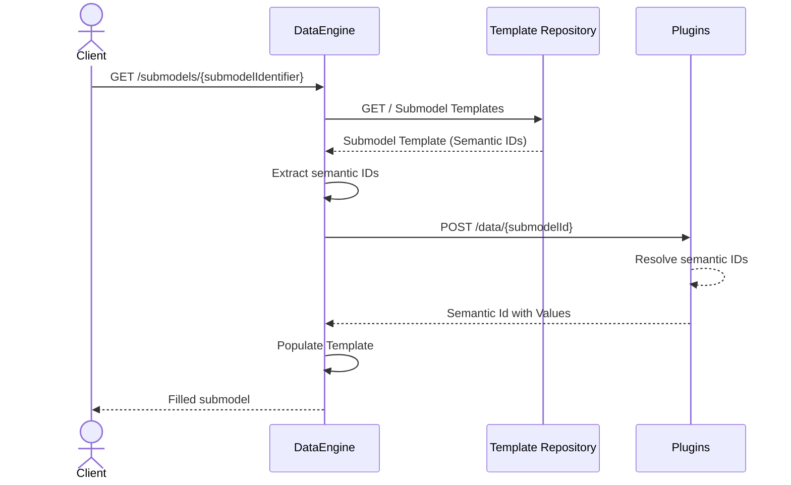

# DataEngine

[](https://www.mm-software.com/)
[](https://www.apache.org/licenses/)
[](https://learn.microsoft.com/en-us/aspnet/core/web-api/?view=aspnetcore-10.0)

## Overview

## DataEngine Overview

**DataEngine** is an API service that dynamically generates complete **Asset Administration Shell (AAS) submodels** by combining standardized AAS templates with provided data from database via plugins.

It acts as the **core orchestration layer** in the TwinEngine ecosystem, transforming static AAS templates into **live, ready-to-consume AAS representations** through a **plugin-based value resolution mechanism**.

DataEngine integrates seamlessly with **Eclipse BaSyx** components and is also capable of orchestrating other **open-source AAS-related components**, enabling a **flexible, vendor-neutral AAS infrastructure**.

---

## Features Overview

- **Template-based Dynamic AAS and Submodel Generation**  
  Dynamically builds complete AAS structures using standardized, reusable templates (containing semantic IDs without values).
    - For more info : [Template-driven submodel generation](https://github.com/AAS-TwinEngine/AAS.TwinEngine.DataEngine/wiki/Feature-Overview#template-driven-submodel-generation)

- **Schema-driven Plugin Integration**  
  Decouples data access through external Plugin APIs using JSON Schema contracts for type-safe communication.
    - For more info : [Plugin-based value resolution](https://github.com/AAS-TwinEngine/AAS.TwinEngine.DataEngine/wiki/Feature-Overview#plugin-based-value-resolution)

- **IDTA-aligned AAS REST Endpoints**  
  Multiple API endpoints that align with official IDTA AAS specifications, supporting shell descriptor, submodel, and submodel element operations for seamless interoperability.
    - For more info : [Idta-aligned-endpoints](https://github.com/AAS-TwinEngine/AAS.TwinEngine.DataEngine/wiki/Feature-Overview#idta-aligned-endpoints)

- **Multi-Plugin Orchestration**  
  DataEngine supports orchestration across multiple Plugin APIs to resolve runtime data simultaneously.
    - For more info : [Multi-plugin orchestration](https://github.com/AAS-TwinEngine/AAS.TwinEngine.DataEngine/wiki/Feature-Overview#multi-plugin-orchestration)

- **Nested and Hierarchical Submodel Support**  
  Handles complex Submodels with deeply nested and structured SubmodelElements.
    - For more info : [Hierarchical & nested models](https://github.com/AAS-TwinEngine/AAS.TwinEngine.DataEngine/wiki/Feature-Overview#hierarchical--nested-models)

- **Comprehensive SubmodelElement Type Support**  
  Supports a broad range of SubmodelElement types with semantic preservation during population.
    - For more info : [Support for SubmodelElement types](https://github.com/AAS-TwinEngine/AAS.TwinEngine.DataEngine/wiki/Feature-Overview#support-for-submodelelement-types)

## DataEngine - AAS Generation Flow



The DataEngine transforms **static AAS templates** into **live digital representations**.

### Step-by-Step Process

When a client requests AAS data (shell descriptor, submodel, or submodel element):

1. **Fetch Template** - DataEngine retrieves the required AAS/Submodel template from the Template Registry/Template Repository
2. **Extract Semantic IDs** - Identifies all semantic IDs within the template that need values  
3. **Request Data via Schema** - Sends a JSON Schema to the Plugin API describing the structure and semantic IDs needed  
4. **Receive Values** - Plugin queries its database and responds with populated values for the requested semantic IDs  
5. **Populate Template** - DataEngine injects the received values into the template structure  
6. **Return AAS submodel Response** - Responds to the client with a complete, ready-to-use AAS structure


## Shell Template Allowlist Configuration

Configure shell mappings under `TemplateManagement.TemplateMappingRules`. Mappings are evaluated in order; the first match selects the template.

- A nonempty `Allowlist` matches the **product ID extracted by `AasIdExtractionRules`**, not the full shell identifier. Configure a rule that extracts and, when specified, validates the product ID for your shell identifiers. Startup validation requires at least one extraction rule. If no rule yields a product ID during a lookup, the provider logs one warning and skips allowlist mappings; a later pattern-only mapping can still match.
- Within a mapping, a nonempty `Allowlist` takes precedence: its `Pattern` entries are ignored, even when extraction fails or the product ID is not allowlisted. Put pattern fallbacks in separate, later mappings.
- Allowlist matching is case-insensitive and accepts an exact product ID or a prefix followed by `-`. For example, `2000-2201` matches `2000-2201-001`, but not `2000-22010` or `2000-2201/001`.
- Entries may be separate array items or pipe-separated values, such as `"2000-2201|2000-2202"`. Surrounding whitespace is trimmed and empty pipe segments are ignored. Use an empty `Allowlist` array for pattern-only matching; patterns are evaluated against the full shell identifier.

Example configuration fragment:

```json
{
  "TemplateManagement": {
    "TemplateMappingRules": {
      "AasIdExtractionRules": [
        {
          "Strategy": "Regex",
          "Pattern": "^https?://[^/]+/ids/aas/([^/]+)$",
          "Index": 1
        }
      ],
      "ShellTemplateMappings": [
        {
          "TemplateId": "urn:example:template:pcf",
          "Allowlist": ["2000-2201", "2000-2202"]
        },
        {
          "TemplateId": "urn:example:template:default",
          "Pattern": [".*"]
        }
      ]
    }
  }
}
```

For `https://example.com/ids/aas/2000-2201-001`, this rule extracts `2000-2201-001` and selects `urn:example:template:pcf` via the hyphen-prefix match. Shell-template and submodel-reference resolution extract the product ID once and reuse it for template selection and submodel URLs, without caching shell identifiers. Template-ID-only lookups skip extraction when no mapping has an allowlist. Hyphen-prefix matching uses hash lookups of identifier prefixes rather than scanning all allowlist entries.

## **Quick Start Guide**

### Running the Setup With DPP Plugin 

1. **Clone or extract this repository:**
   ```bash
   git clone https://github.com/AAS-TwinEngine/AAS.TwinEngine.DataEngine.git
   cd AAS.TwinEngine.DataEngine/examples/AAS.TwinEngine.Minimal
   ```

2. **Start all services:**
   ```bash
   docker-compose up -d
   ```

3. **Access the Web UI:**
   Open your browser and navigate to:
   ```
   http://localhost:8080/aas-ui/
   ```
- For more info : [TwinEngine Demonstrator Setup](examples/AAS.TwinEngine.Minimal/README.md)
---

