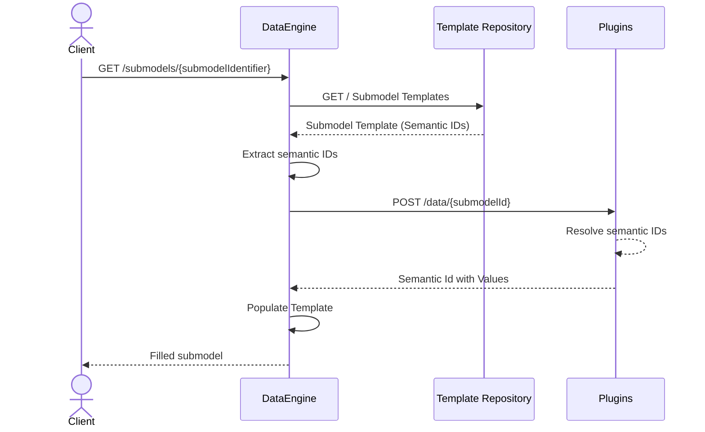
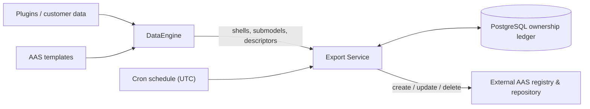

# DataEngine

[](https://www.mm-software.com/)
[](https://www.apache.org/licenses/)
[](https://learn.microsoft.com/en-us/aspnet/core/web-api/?view=aspnetcore-10.0)

## Overview

**DataEngine** is an API service that dynamically generates complete **Asset Administration Shell (AAS) submodels** by combining standardized AAS templates with provided data from database via plugins.

It acts as the **core orchestration layer** in the TwinEngine ecosystem, transforming static AAS templates into **live, ready-to-consume AAS representations** through a **plugin-based value resolution mechanism**.

DataEngine integrates seamlessly with standard **AAS registry and repository** components and is also capable of orchestrating other **open-source AAS-related components**, enabling a **flexible, vendor-neutral AAS infrastructure**.

The repository also contains the **Export Service**, which periodically publishes the generated AAS shells, submodels and descriptors to an external AAS registry/repository. See [Export Service](#export-service).

---

## Features Overview

- **Template-based Dynamic AAS and Submodel Generation**  
  Dynamically builds complete AAS structures using standardized, reusable templates (containing semantic IDs without values).
    - For more info : [Template-driven submodel generation](https://github.com/AAS-TwinEngine/AAS.TwinEngine.DataEngine/wiki/Feature-Overview#template-driven-submodel-generation)

- **Template-defined Values**  
  Values that are already set in a template are kept as they are and are not requested from plugins, e.g. a fixed manufacturer name.

- **Schema-driven Plugin Integration**  
  Decouples data access through external Plugin APIs using JSON Schema contracts for type-safe communication.
    - For more info : [Plugin-based value resolution](https://github.com/AAS-TwinEngine/AAS.TwinEngine.DataEngine/wiki/Feature-Overview#plugin-based-value-resolution)

- **IDTA-aligned AAS REST Endpoints**  
  Multiple API endpoints that align with official IDTA AAS specifications, supporting shell descriptor, submodel, and submodel element operations for seamless interoperability.
    - For more info : [Idta-aligned-endpoints](https://github.com/AAS-TwinEngine/AAS.TwinEngine.DataEngine/wiki/Feature-Overview#idta-aligned-endpoints)

- **Multi-Plugin Orchestration**  
  DataEngine supports orchestration across multiple Plugin APIs to resolve runtime data simultaneously.
    - For more info : [Multi-plugin orchestration](https://github.com/AAS-TwinEngine/AAS.TwinEngine.DataEngine/wiki/Feature-Overview#multi-plugin-orchestration)

- **Nested and Hierarchical Submodel Support**  
  Handles complex Submodels with deeply nested and structured SubmodelElements.
    - For more info : [Hierarchical & nested models](https://github.com/AAS-TwinEngine/AAS.TwinEngine.DataEngine/wiki/Feature-Overview#hierarchical--nested-models)

- **Comprehensive SubmodelElement Type Support**  
  Supports a broad range of SubmodelElement types with semantic preservation during population.
    - For more info : [Support for SubmodelElement types](https://github.com/AAS-TwinEngine/AAS.TwinEngine.DataEngine/wiki/Feature-Overview#support-for-submodelelement-types)

- **Export Service**  
  Periodically exports the generated AAS entities to an external AAS registry/repository, with incremental sync and an ownership ledger so that target-owned data is never touched.
    - For more info : [Export Service](#export-service)

## DataEngine - AAS Generation Flow



The DataEngine transforms **static AAS templates** into **live digital representations**.

### Step-by-Step Process

When a client requests AAS data (shell descriptor, submodel, or submodel element):

1. **Fetch Template** - DataEngine retrieves the required AAS/Submodel template from the Template Registry/Template Repository
2. **Extract Semantic IDs** - Identifies all semantic IDs within the template that need values  
3. **Request Data via Schema** - Sends a JSON Schema to the Plugin API describing the structure and semantic IDs needed  
4. **Receive Values** - Plugin queries its database and responds with populated values for the requested semantic IDs  
5. **Populate Template** - DataEngine injects the received values into the template structure  
6. **Return AAS submodel Response** - Responds to the client with a complete, ready-to-use AAS structure


---

## Export Service

The **Export Service** (`source/AAS.TwinEngine.ExportService`) is a separate, scheduled service that **materializes** the AAS entities generated by DataEngine into an **external AAS registry/repository**. This is useful for consumers that need the shells and submodels to exist in their own AAS infrastructure instead of being generated on request.



### Key capabilities

- **Scheduled, one-way synchronization** - runs on a cron expression with a configurable run timeout; source changes (created, updated or deleted) are reflected in the target on the next run.
- **Incremental sync** - compares source and target by content hash and only creates, updates or deletes what changed; unchanged entities are skipped.
- **Ownership ledger** - managed entities are recorded in a PostgreSQL state store. The exporter only updates or deletes entities it owns, so target-only data is never modified.
- **Complete AAS coverage** - exports concept descriptions, submodels, submodel descriptors, shells and shell descriptors in dependency order. Each entity kind can be enabled, disabled or pointed at a different host.
- **Reliable by design** - HTTP retries with exponential backoff and jitter, per-request timeouts, parallel processing and configurable source paging (`SourcePageRequestDelayMilliseconds`) for large datasets.
- **Secure target access** - optional authentication per endpoint: `None`, `StaticBearer` or `OAuth2ClientCredentials`.
- **Clear run results** - every run ends as `Success`, `PartialFailure`, `FullFailure` or `Aborted`, with a per-phase summary in the logs.
- **Health and observability** - aggregate readiness at `/healthz` and OpenTelemetry traces, logs and metrics (for example in Grafana).

### Try it

The [DPP-API demonstrator](examples/AAS.TwinEngine.DPP-API/README.md) runs DataEngine, the DPP Plugin, a source and a target AAS environment, the Export Service and a DPP API together. The target UI initially shows only a pre-existing target-owned shell; after the next scheduled run (every 3 minutes) the exported shells and submodels appear next to it, and the target-owned shell stays untouched. The DPP API then serves Digital Product Passports from the exported data.

```bash
git clone https://github.com/AAS-TwinEngine/AAS.TwinEngine.DataEngine.git
git clone https://github.com/AAS-TwinEngine/AAS.TwinEngine.Plugin.DPP.git
cd AAS.TwinEngine.DataEngine/examples/AAS.TwinEngine.DPP-API
docker compose up -d --build
```

Open `http://localhost:8080/aas-ui/` to watch the export, and `http://localhost:8083/swagger` to call the DPP API. The demonstrator builds the Export Service (and the DPP Plugin) from source, so both repositories must be cloned side by side.

---

## **Quick Start Guide**

### Running the Setup With DPP Plugin 

1. **Clone or extract this repository:**
   ```bash
   git clone https://github.com/AAS-TwinEngine/AAS.TwinEngine.DataEngine.git
   cd AAS.TwinEngine.DataEngine/examples/AAS.TwinEngine.Minimal
   ```

2. **Start all services:**
   ```bash
   docker-compose up -d
   ```

3. **Access the Web UI:**
   Open your browser and navigate to:
   ```
   http://localhost:8080/aas-ui/
   ```
- For more info : [TwinEngine Demonstrator Setup](examples/AAS.TwinEngine.Minimal/README.md)

### Examples

| Example | Description |
|---|---|
| [AAS.TwinEngine.Minimal](examples/AAS.TwinEngine.Minimal/README.md) | DataEngine with the DPP Plugin, an AAS registry/repository and the AAS Web UI |
| [AAS.TwinEngine.DPP-API](examples/AAS.TwinEngine.DPP-API/README.md) | Minimal example plus the Export Service, a second target AAS environment and a DPP API that serves Digital Product Passports from the exported data |
| [AAS.TwinEngine.Observability](examples/AAS.TwinEngine.Observability/README.md) | Minimal example with Grafana, Prometheus and a bulk data loader for load and performance tests |
| [AAS.TwinEngine.Secured](examples/AAS.TwinEngine.Secured/README.md) | Minimal example secured with Keycloak (OIDC) and ABAC |

---

