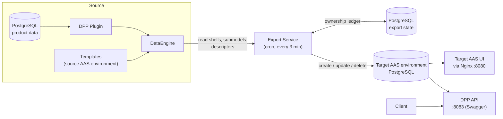

# TwinEngine DPP API Example

## Overview

This example shows the full path from product data to **Digital Product Passports (DPP)**:

1. **DataEngine** and the **DPP Plugin** generate AAS shells and submodels from templates and database values (the **source**).
2. The **Export Service** periodically copies them to a second, independent AAS environment (the **target**).
3. The **DPP API** reads the exported data from the target database and serves Digital Product Passports through standard DPP retrieval operations.

> **Note:** This example uses the BaSyx Go standard AAS APIs for the source and target AAS registries and repositories, and the BaSyx Go DPP API.



The target already contains one target-owned shell (`PreExistingTargetAsset`). The Export Service never modifies it, because it only manages entities recorded in its own ownership ledger. The DPP API reads from the target database; it does not call DataEngine for each request.

## Included Submodel Templates

**Nameplate**, **MaintenanceInstructions**, **TechnicalData**, **CarbonFootprint**, **HandoverDocumentation** and **DPP Metadata**.

## Quick Start

**Prerequisites:** Docker and Docker Compose, and free ports `8080` (target gateway and UI), `8081` (pgAdmin), `8083` (DPP API), `8092` (target registry/repository), `3000` (Grafana) and `9090` (Prometheus).

Clone both repositories side by side:

```
TwinEngine/
├── AAS.TwinEngine.DataEngine/
└── AAS.TwinEngine.Plugin.DPP/
```

Start the demo:

```bash
cd AAS.TwinEngine.DataEngine/examples/AAS.TwinEngine.DPP-API
docker compose up -d --build
docker compose ps
```

The `--build` flag is required because this example builds the Export Service (and the DPP Plugin) from local source. Do not run another TwinEngine example at the same time, because the examples share container names and ports.

## Using the DPP API

After the first export run has finished, open Swagger at [http://localhost:8083/swagger](http://localhost:8083/swagger) and call `ReadDPPById` or `ReadDPPByProductId`. Use the server `http://localhost:8083` in Swagger (port `8080` is the AAS gateway). Identifiers must be URL-encoded when used in the path (for example with `encodeURIComponent`).

Identifiers in the shared seed:

| Product | DPP ID (shell ID) for `ReadDPPById` | Product ID (global asset ID) for `ReadDPPByProductId` |
|---|---|---|
| Product1 | `https://mm-software.com/ids/aas/000-001` | `https://mm-software.com/ids/assets/000-001` |
| Product2 | `https://mm-software.com/ids/aas/000-002` | `https://mm-software.com/ids/assets/000-002` |
| Product3 | `https://mm-software.com/ids/aas/001-001` | `https://mm-software.com/ids/assets/001-001` |

For successful retrieval, the DPP metadata, shell IDs and referenced submodels must match the plugin and API mappings.

The [apiCollection](apiCollection) folder contains ready-to-use requests (Bruno / OpenCollection) for reading a DPP by DPP ID or product ID, a compressed or full representation, a single data element and historical DPP versions. The target repository runs with audit history enabled, which the historical versions require.

## Services and Ports

| Service | Port | Role |
|---|---|---|
| **nginx** | 8080 | Target API gateway and target UI at `/aas-ui/` |
| **twinengine-dataengine** | - | Source: builds AAS data from templates and plugin data |
| **dpp-plugin** | - | Source: Digital Product Passport plugin (PostgreSQL backed) |
| **source-registry-repository** | - | Source: AAS environment with the 6 templates |
| **export-service** | - | Reads from the source and writes to the target on a cron schedule |
| **target-registry-repository** | 8092 | Target: independent AAS environment with one target-owned shell |
| **aas-ui-target** | - | Target AAS UI, reachable only through nginx |
| **dpp-api** | 8083 | Serves Digital Product Passports from the target data |
| **postgres** | - | Hosts the `twinengine`, `basyxSourceDB`, `basyxTargetDB` and `exportstate` databases |
| **pgadmin** | 8081 | Database administration (`admin@example.com` / `admin`) |
| **otel-lgtm** | 3000, 9090 | Grafana and Prometheus |

## Observability

DataEngine, the DPP Plugin and the Export Service send traces, logs and metrics to Grafana at `http://localhost:3000` (no login). In **Explore → Tempo**, search for the service `ExportService` to follow one export run end to end. This is a development setup without authentication or persistence.


## Troubleshooting

| Symptom | Check |
|---|---|
| Entities are missing in the target | `docker compose logs export-service` for `Failed to Create` or `failed with status` errors |
| Run status is `Aborted` | The source returned an error. Check `docker compose logs twinengine-dataengine`. After a plugin rebuild, restart DataEngine because it reads the plugin's supported Semantic IDs at startup |
| DPP retrieval returns `404` | Check that the first export has finished and that the DPP metadata, shell IDs and submodels match the configured mappings |
| Swagger reports CORS or `Failed to fetch` | In Swagger, use the server `http://localhost:8083`. Port `8080` is the AAS gateway |
| Target repository is unhealthy | `docker compose logs target-registry-repository basyx_configuration_target postgres`, and wait for database initialization |
| Export Service does not start | `docker compose ps`; make sure `postgres` is healthy and `target-registry-repository` has started |
| Port already in use | Change the host-side port mapping in `docker-compose.yml` |

## More Information

- [Large datasets](../AAS.TwinEngine.Observability/databaseBulkDataLoader/README.md) - bulk data loader (raise the cron interval, timeout and parallelism first)
