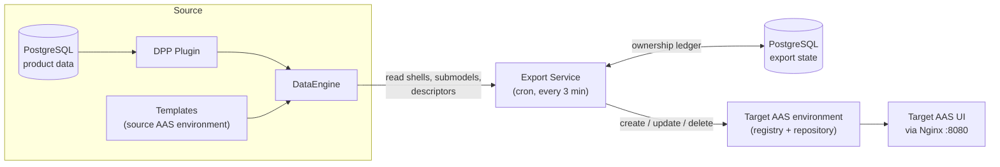

# TwinEngine Export Service Example

## Overview

This example extends [`AAS.TwinEngine.Minimal`](../AAS.TwinEngine.Minimal/README.md) with a second, independent AAS environment that acts as an external AAS Registry/Repository, and runs the **Export Service** against it.

The Export Service periodically reads the shells, submodels and descriptors generated by DataEngine (the **source**) and writes them to the external registry/repository (the **target**). The result is visible live in the target AAS Web UI.

> **Note:** This example uses the BaSyx Go standard AAS APIs for the source and target AAS registries and repositories.



The target already contains one target-owned shell (`PreExistingTargetAsset`). The Export Service never modifies it, because it only manages entities recorded in its own ownership ledger.

## Included Submodel Templates

Same as the Minimal example: **Nameplate**, **MaintenanceInstructions**, **TechnicalData**, **CarbonFootprint**, **HandoverDocumentation** and **DPP Metadata**.

## Quick Start

**Prerequisites:** Docker and Docker Compose, and free ports `8080` (target gateway and UI), `8081` (pgAdmin), `3000` (Grafana), `9090` (Prometheus) and `8092` (target registry/repository).

Clone both repositories side by side:

```
TwinEngine/
├── AAS.TwinEngine.DataEngine/
└── AAS.TwinEngine.Plugin.DPP/
```

Start the demo:

```bash
cd AAS.TwinEngine.DataEngine/examples/AAS.TwinEngine.Minimal.Export
docker compose up -d --build
```

The `--build` flag is required because this example builds the Export Service (and the DPP Plugin) from local source.

## Watching the Export

1. Open the target UI: `http://localhost:8080/aas-ui/`. It shows only the pre-existing `PreExistingTargetAsset` shell.
2. Wait for the next scheduled run (every 3 minutes).
3. Refresh the UI. The exported shells and submodels now appear next to the target-owned shell.
4. Change or delete data at the source (for example in pgAdmin) and wait for the next run. The change is reflected in the target, and the target-owned shell stays untouched.

Follow a run in the logs:

```bash
docker compose logs -f export-service
```

Each run ends with a per-phase summary (`Created`, `Updated`, `Deleted`, `Skipped`, `Failed`) and a status:

| Status | Meaning |
|---|---|
| `Success` | No entity operation failed |
| `PartialFailure` | Some operations succeeded and some failed |
| `FullFailure` | All operations failed |
| `Aborted` | A source or unexpected failure stopped the run to protect data integrity |

> Descriptors are shown as `Updated` on the first run because the target creates them itself when a shell or submodel is written. The next unchanged run reports `Skipped`.


## Services and Ports

| Service | Port | Role |
|---|---|---|
| **nginx** | 8080 | Target API gateway and target UI at `/aas-ui/` |
| **twinengine-dataengine** | - | Source: builds AAS data from templates and plugin data |
| **dpp-plugin** | - | Source: Digital Product Passport plugin (PostgreSQL backed) |
| **source-registry-repository** | - | Source: AAS environment with the 6 templates |
| **export-service** | - | Reads from the source and writes to the target on a cron schedule |
| **target-registry-repository** | 8092 | Target: independent AAS environment with one target-owned shell |
| **aas-ui-target** | - | Target AAS UI, reachable only through nginx |
| **postgres** | - | Hosts the `twinengine`, `basyxSourceDB`, `basyxTargetDB` and `exportstate` databases |
| **pgadmin** | 8081 | Database administration (`admin@example.com` / `admin`) |
| **otel-lgtm** | 3000, 9090 | Grafana and Prometheus |

## Observability

DataEngine, the DPP Plugin and the Export Service send traces, logs and metrics to Grafana at `http://localhost:3000` (no login). In **Explore → Tempo**, search for the service `ExportService` to follow one export run end to end. This is a development setup without authentication or persistence.

## Troubleshooting

| Symptom | Check |
|---|---|
| Entities are missing in the target | `docker compose logs export-service` for `Failed to Create` or `failed with status` errors |
| Run status is `Aborted` | The source returned an error. Check `docker compose logs twinengine-dataengine`. After a plugin rebuild, restart DataEngine because it reads the plugin's supported Semantic IDs at startup |
| Export Service does not start | `docker compose ps`; make sure `postgres` is healthy and `target-registry-repository` has started |
| Port already in use | Change the host-side port mapping in `docker-compose.yml` |

## More Information

- [Large datasets](../AAS.TwinEngine.Observability/databaseBulkDataLoader/README.md) - bulk data loader (raise the cron interval, timeout and parallelism first)

