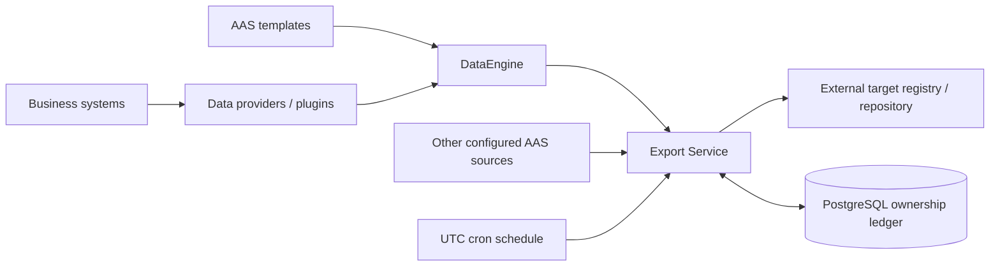
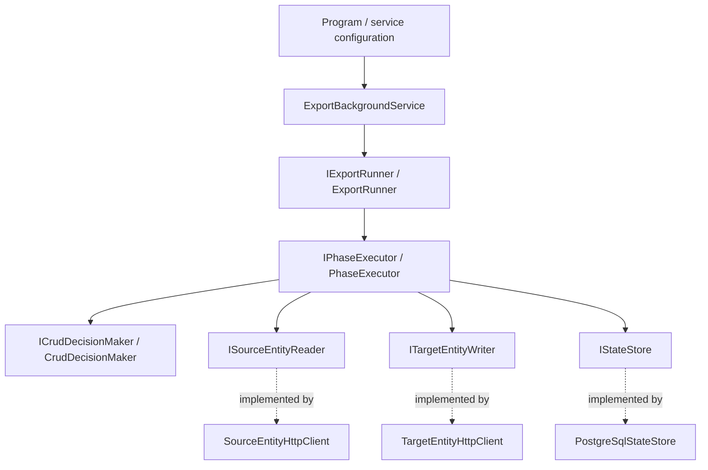
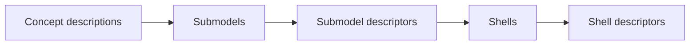
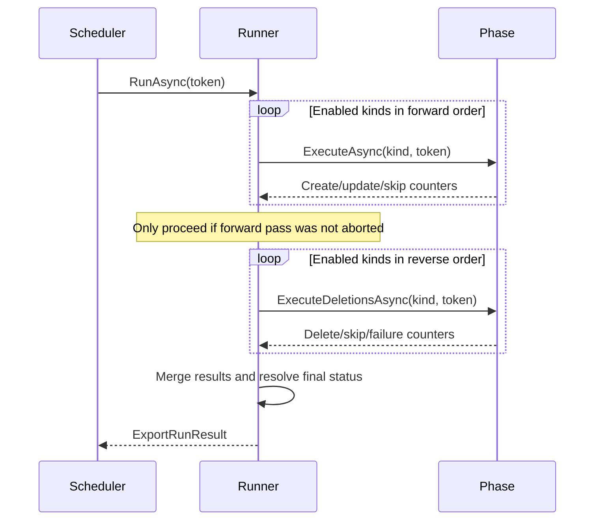
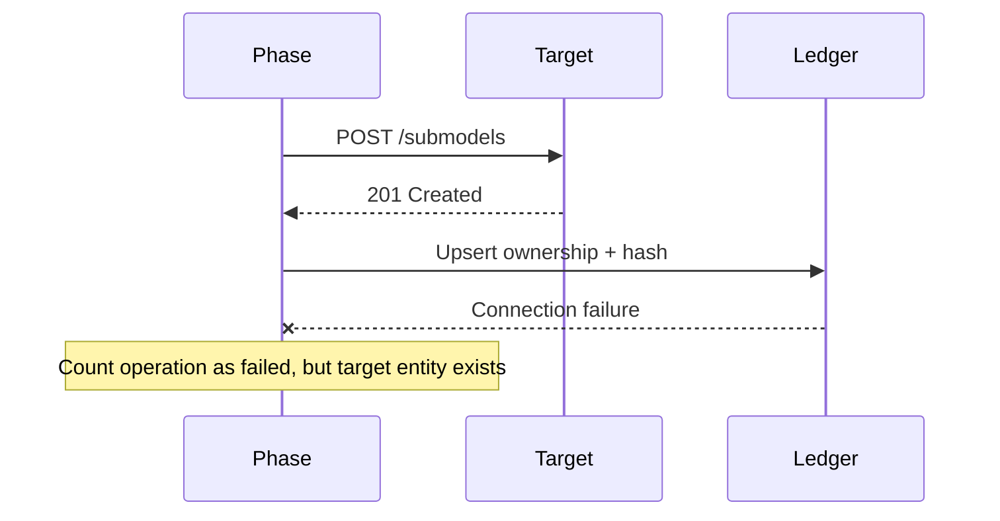
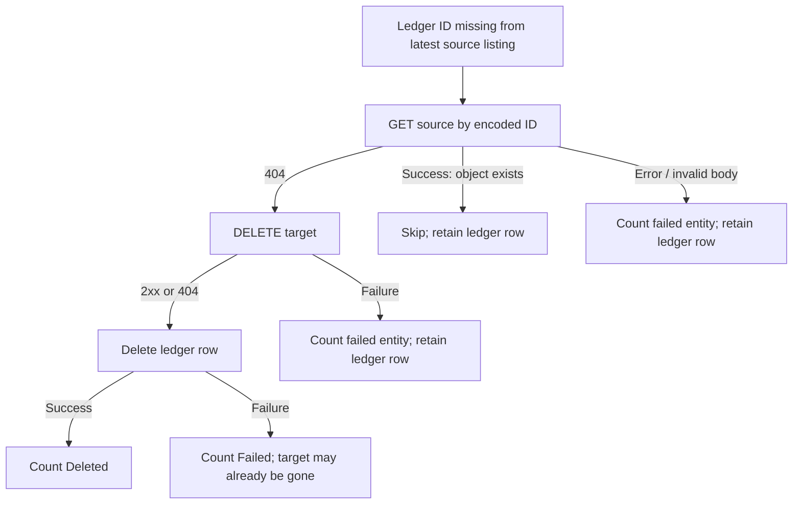

# Export Service: In-Depth Code and Execution Guide

> **Audience:** developers, technical leads, QA engineers, and operators.
> **Reviewed against:** the working-tree implementation on 2026-10-19.
> **Scope:** the complete Export Service, including dependency health checks.
> **Reading rule:** code excerpts are selected implementation excerpts unless explicitly
> labelled as pseudocode or illustrative data. Examples with reduced AAS objects explain
> exporter behavior; they are not complete, specification-conformance fixtures.

## Contents

1. [Purpose and mental model](#1-purpose-and-mental-model)
2. [Architecture and code map](#2-architecture-and-code-map)
3. [Domain objects](#3-domain-objects)
4. [Startup and dependency injection](#4-startup-and-dependency-injection)
5. [Scheduling, locking, and run lifetime](#5-scheduling-locking-and-run-lifetime)
6. [Run orchestration and dependency ordering](#6-run-orchestration-and-dependency-ordering)
7. [Inside a phase](#7-inside-a-phase)
8. [Source reads, parsing, and pagination](#8-source-reads-parsing-and-pagination)
9. [Hashing and CRUD decisions](#9-hashing-and-crud-decisions)
10. [Target HTTP writes](#10-target-http-writes)
11. [Payload normalization](#11-payload-normalization)
12. [Ownership ledger and PostgreSQL](#12-ownership-ledger-and-postgresql)
13. [Deletion verification and safety boundaries](#13-deletion-verification-and-safety-boundaries)
14. [Authentication](#14-authentication)
15. [Retries, backoff, and timeout layers](#15-retries-backoff-and-timeout-layers)
16. [Run results and exception propagation](#16-run-results-and-exception-propagation)
17. [Liveness and readiness: detailed code walkthrough](#17-liveness-and-readiness-detailed-code-walkthrough)
18. [Configuration reference](#18-configuration-reference)
19. [Worked lifecycle examples](#19-worked-lifecycle-examples)
20. [Failure and edge-case matrix](#20-failure-and-edge-case-matrix)
21. [Logs, tracing, and operational diagnosis](#21-logs-tracing-and-operational-diagnosis)
22. [Running and validating locally](#22-running-and-validating-locally)
23. [Test map and scenario design](#23-test-map-and-scenario-design)
24. [Current limitations and safe extension points](#24-current-limitations-and-safe-extension-points)

---

## 1. Purpose and mental model

### 1.1 Why this service exists

DataEngine generates AAS representations dynamically from templates and plugin data.
Some consumers instead require those representations to exist in an independent
AAS registry/repository. The Export Service periodically materializes source entities
into configured target systems.

This is **scheduled, one-way synchronization**, not an inbound request proxy and not
bidirectional data reconciliation.



The source can be DataEngine, a gateway in front of DataEngine, or another compatible
HTTP source. Entity kinds can have different source and target hosts.

### 1.2 The three data sets

For any entity kind, keep three sets separate:

| Set | Meaning | Read by the exporter? |
|---|---|---|
| Source entities | Current source representation of the desired entities | Yes, collection reads and deletion verification |
| Managed state | Identifiers and hashes previously recorded by this exporter | Yes, PostgreSQL |
| Target contents | Actual entities currently stored by the destination | Not enumerated for reconciliation |

The exporter compares **source versus ledger**, not source versus target.
This explains both its ownership safety and its drift-repair limitations.

### 1.3 Rules that are easy to misunderstand

- An identifier missing from state produces a **Create** decision. It does not prove
  that the target is empty. A target that generates registry descriptors can already hold the
  descriptor the exporter is about to create; see
  [13.6](#136-descriptor-conflicts-and-registry-integrated-targets).
- An identifier in state with an unchanged source hash produces **Skip**. The target
  is not read to verify that its current contents still match.
- A ledger entry missing from a source listing is only a **deletion candidate**.
  A separate source GET-by-ID must confirm absence before deletion.
- Entity kinds are ordered; entities within one phase are processed concurrently.
- A healthy host is not the same as a healthy dependency graph.
- A successful run can contain zero writes.
- A run is not a transaction across HTTP destinations and PostgreSQL.

> **Important current-code behavior:** [TargetEntityHttpClient](./Infrastructure/Http/Clients/TargetEntityHttpClient.cs)
> reports a create conflict (`409`) as `TargetEntityConflictException` and never decides to
> overwrite. The only case that is reconciled is a registry descriptor whose described shell or
> submodel is already exporter-managed, which
> [13.6](#136-descriptor-conflicts-and-registry-integrated-targets) explains. Older
> descriptions of unconditional POST-to-PUT upsert behavior do not describe this version.

## 2. Architecture and code map

### 2.1 Responsibility boundaries



The interfaces separate orchestration from external I/O. The directories express
layering inside one web project; they are not separate assembly-level dependency
boundaries. Application services currently also consume configuration types from
the service-configuration namespace.

### 2.2 Where to start reading

| Concern | Owning implementation | Question answered |
|---|---|---|
| Host bootstrap | [Program](./Program.cs) | What starts and what HTTP routes are exposed? |
| Registration | [InfrastructureDependencyInjectionExtensions](./ServiceConfiguration/InfrastructureDependencyInjectionExtensions.cs) | Which external services and clients are wired? |
| Application services | [ApplicationDependencyInjectionExtensions](./ServiceConfiguration/ApplicationDependencyInjectionExtensions.cs) | Which orchestration implementations are injected? |
| Schedule | [ExportBackgroundService](./Infrastructure/Scheduling/ExportBackgroundService.cs) | When does a run start and how is it bounded? |
| Run ordering | [ExportRunner](./ApplicationLogic/Services/Export/ExportRunner.cs) | Which entity kind executes next? |
| Entity execution | [PhaseExecutor](./ApplicationLogic/Services/Export/PhaseExecutor.cs) | How is a decision applied and counted? |
| Decision logic | [CrudDecisionMaker](./ApplicationLogic/Services/Crud/CrudDecisionMaker.cs) | Why Create, Update, Skip, or Delete? |
| Source I/O | [SourceEntityHttpClient](./Infrastructure/Http/Clients/SourceEntityHttpClient.cs) | How are source pages and individual entities read? |
| Target I/O | [TargetEntityHttpClient](./Infrastructure/Http/Clients/TargetEntityHttpClient.cs) | What POST, PUT, and DELETE requests are sent? |
| Database | [PostgreSqlStateStore](./Infrastructure/State/DataAccess/PostgreSqlStateStore.cs) | When does ownership state change? |
| SQL | [StateStoreQueries](./Infrastructure/State/DataAccess/StateStoreQueries.cs) | What is stored and how is it updated? |
| HTTP resilience | [ResilienceHandlerExtensions](./Infrastructure/Http/Policies/ResilienceHandlerExtensions.cs) | Which timeout and retry policy wraps requests? |
| Health registration/routes | [ExportServiceHealthCheckExtensions](./ServiceConfiguration/ExportServiceHealthCheckExtensions.cs) | What does readiness include? |
| HTTP dependency probe | [EndpointHealthCheck](./Infrastructure/Monitoring/EndpointHealthCheck.cs) | How is a dependency checked? |
| Database probe | [StateStoreHealthCheck](./Infrastructure/Monitoring/StateStoreHealthCheck.cs) | What does database readiness prove? |

## 3. Domain objects

### 3.1 Source entity

[SourceEntity](./DomainModel/SourceEntity.cs) contains:

```csharp
public sealed record SourceEntity(string Identifier, string RawJson)
{
    public string ContentHash =>
        Convert.ToHexString(SHA256.HashData(Encoding.UTF8.GetBytes(RawJson)));
}
```

- `Identifier` is the logical AAS identifier, not its URL encoding.
- `RawJson` is the object's source JSON text.
- `ContentHash` is an uppercase hexadecimal SHA-256 digest of that text.
- The hash property computes on access; it is not a stored field in the record.

The stored hash detects source representation changes. It is not a target checksum,
signature, semantic AAS equivalence check, or proof that a target write is still present.

### 3.2 Managed entity

[ExportedEntity](./DomainModel/ExportedEntity.cs) tracks the kind, identifier,
creation timestamp, last synchronization timestamp, and nullable content hash.
It does not store the full exported payload.

The same identifier can be tracked independently under different entity kinds
because the ledger key includes both kind and identifier.

### 3.3 Decisions and results

- [CrudDecision](./ApplicationLogic/Services/Crud/CrudDecision.cs):
  operation, kind, identifier, and optional source entity. Delete has no source payload.
- [PhaseResult](./DomainModel/PhaseResult.cs):
  `Created`, `Updated`, `Deleted`, `Skipped`, `Failed`, and `HasFailures`.
- [ExportRunResult](./DomainModel/ExportRunResult.cs):
  start/end times, final status, and results of completed phases.

Counters describe completed application operations, including their ledger work.
They are not simply HTTP response counters.

## 4. Startup and dependency injection

### 4.1 Step-by-step startup

The entry point in [Program](./Program.cs) performs:

```csharp
var builder = WebApplication.CreateBuilder(args);
builder.ConfigureLogging(builder.Configuration);

_ = builder.Services
    .ConfigureInfrastructure(builder.Configuration)
    .ConfigureApplication();

var app = builder.Build();
_ = app.MapExportHealthChecks();
```

The host then runs asynchronously and flushes Serilog in a `finally` block.
There is no public export-trigger controller in this implementation.

### 4.2 Configuration binding is an early gate

[ConfigureInfrastructure](./ServiceConfiguration/InfrastructureDependencyInjectionExtensions.cs)
binds the `ExportService` section, validates it, and throws
`OptionsValidationException` when validation fails.

```csharp
var rootConfig = new ExportServiceConfig();
configuration.GetSection(ExportServiceConfig.Section).Bind(rootConfig);
var validation = new ExportServiceConfigValidator()
    .Validate(Options.DefaultName, rootConfig);
```

The bound object is registered as a singleton `IOptions<ExportServiceConfig>`.
This is not an `IOptionsMonitor` implementation with automatic live reconfiguration.
Restart/recreate the service after changing deployed settings.

### 4.3 Registered service lifetimes

| Component | Lifetime / construction | Why it matters |
|---|---|---|
| Bound options | Singleton | One configuration snapshot |
| `ICrudDecisionMaker` | Singleton | Stateless decision function |
| `IExportRunner`, `IPhaseExecutor` | Scoped | Fresh run scope |
| Source reader / target writer | Scoped | Used by a run's phase executor |
| `IStateStore` | Scoped | Database operations within run scope |
| `IDbConnectionFactory` | Singleton | Creates Npgsql connection instances |
| `ITokenProvider` | Singleton | Token cache survives across run scopes |
| `IExportRunLock` | Singleton | Prevents overlapping acquisitions inside one process |
| Schema initializer / scheduler | Hosted services | Participate in host startup and shutdown |
| HTTP clients | Named factory clients | Endpoint-specific address, auth, and policies |

The scheduler creates a dependency-injection scope for each acquired run.
It does not resolve a scoped runner once and keep it forever.

### 4.4 Schema initialization precedes normal operation

[StateSchemaInitializer](./Infrastructure/State/Migrations/StateSchemaInitializer.cs)
is an `IHostedService`. Its startup method resolves `IStateStore` in a scope and awaits
`EnsureSchemaAsync`.

Consequences:

1. Invalid connection settings or unavailable PostgreSQL can prevent startup.
2. Database privileges must allow the schema/table initialization statements.
3. Disabling the scheduler does not disable schema initialization.
4. Liveness/readiness endpoints cannot be relied on to describe a process that never
   completed host startup.

The schema initialization is idempotent DDL, not a complete migration framework.

## 5. Scheduling, locking, and run lifetime

### 5.1 Scheduler algorithm

[ExportBackgroundService](./Infrastructure/Scheduling/ExportBackgroundService.cs):

```text
Read Scheduler settings
  -> if disabled, log and exit the background loop
Parse five-field cron
Repeat until shutdown:
  compute next occurrence using UTC
  wait until that occurrence
  execute TickAsync
  after TickAsync finishes, compute the next future occurrence
```

There is no unconditional immediate export at application startup.

### 5.2 Cron examples

| Expression | Meaning in this service |
|---|---|
| `* * * * *` | Every minute |
| `*/5 * * * *` | At minute values divisible by five |
| `0 * * * *` | At the start of each hour |
| `0 2 * * *` | Daily at 02:00 UTC |
| `0 9 * * 1-5` | Weekdays at 09:00 UTC |

These are cron boundaries, not "wait N minutes after the previous export."

**Example:** host starts at 12:01:20 UTC with `*/5 * * * *`.
The next run is approximately 12:05:00, not 12:06:20.

### 5.3 Long runs do not create a backlog

The background loop awaits the run before computing the next occurrence.
If a run starts at 12:00 and finishes at 12:08 with a five-minute schedule,
the next occurrence is 12:10. The missed 12:05 occurrence is not replayed.

The lock also protects against another caller acquiring the same in-process lock.
The normal single scheduler loop is already sequential.

### 5.4 What the run lock guarantees

[ExportRunLock](./Infrastructure/Scheduling/ExportRunLock.cs):

```csharp
if (Interlocked.CompareExchange(ref _busy, 1, 0) != 0)
{
    return null;
}
```

Successful acquisition returns a disposable releaser. Disposing it releases the flag,
and repeated disposal is protected.

This is **not a distributed lock**. Two containers have two independent locks.
Do not assume that scaling the exporter to multiple replicas gives safe leader election.

### 5.5 Run timeout

For an acquired tick:

```csharp
using var timeoutCts =
    CancellationTokenSource.CreateLinkedTokenSource(stoppingToken);
timeoutCts.CancelAfter(timeout);
```

The linked token represents either host shutdown or configured run timeout.
Cancellation is cooperative: work must observe the token. It is not a rollback,
forced process kill, or guarantee that a remote server did not finish a request.

The scheduler logs a specific timeout message when run timeout occurs without host shutdown.
It logs other unhandled run exceptions separately. See the current cancellation caveats
in [exception propagation](#16-run-results-and-exception-propagation).

## 6. Run orchestration and dependency ordering

### 6.1 The phase order is explicit

[ExportRunner](./ApplicationLogic/Services/Export/ExportRunner.cs) defines:

```csharp
private static readonly EntityKind[] PhaseOrder =
[
    EntityKind.ConceptDescription,
    EntityKind.Submodel,
    EntityKind.SubmodelDescriptor,
    EntityKind.Shell,
    EntityKind.ShellDescriptor
];
```

Forward work follows this order; deletion follows its reverse.



The intent is dependency-first creation/update and dependent-first deletion.
The exporter does not dynamically inspect every reference and topologically sort objects.
Order within the same entity kind is not deterministic.

### 6.2 Source enablement controls both directions

A phase is active only when:

```text
Sources.<Kind>.Enabled
```

Set `Enabled` only under `Sources`. A true source flag enables reads and writes to
the matching target; false skips both forward and deletion work for that kind.
Legacy `Targets.<Kind>.Enabled` settings are ignored. Both endpoints must be valid
when the source is enabled; neither is required when the source is disabled.

There is no automatic activation of a dependency kind. If only shells are enabled,
the exporter does not automatically export their submodels.

### 6.3 Two-pass orchestration



### 6.4 What stops the second pass?

An escaped `SourceUnavailableException` or unexpected phase-level exception aborts
the remaining work. A propagated cancellation interrupts execution rather than
returning a normal final result.

An ordinary failed target write is isolated inside the phase. It does **not**
automatically abort later kinds or prevent the deletion pass.
Thus ordering is not the same as a guarantee that every dependency was successfully created.

## 7. Inside a phase

### 7.1 Shared algorithm for forward and deletion work

[PhaseExecutor](./ApplicationLogic/Services/Export/PhaseExecutor.cs) exposes two entry points:

```csharp
public Task<PhaseResult> ExecuteAsync(EntityKind kind, CancellationToken cancellationToken)
  => ExecuteAsync(kind, false, cancellationToken);

public Task<PhaseResult> ExecuteDeletionsAsync(EntityKind kind, CancellationToken cancellationToken)
  => ExecuteAsync(kind, true, cancellationToken);
```

Both calls use page-bounded processing:

1. Start an export-phase activity and log the kind.
2. Load and index the managed ledger rows for the kind once.
3. Enumerate source pages through `ISourceEntityReader.ReadPagesAsync`.
4. In the forward pass, calculate decisions using only the current page and its matching ledger rows.
5. Complete the page's forward decisions with bounded parallelism before requesting another page.
6. In the deletion pass, retain only source identifiers; after the entire scan succeeds,
   calculate missing managed identifiers and verify each candidate by GET-by-ID before deletion.
7. Return counters and log the phase summary.

**Important:** the deletion pass does not reuse the forward pass's source snapshot.
For each enabled kind there are normally two full listing reads per run.
If a later source page fails, earlier forward-page writes and their ledger updates remain;
the runner aborts remaining phases and does not start the deletion pass. A failed deletion
listing never authorizes deletions for that kind.

### 7.2 Why the second listing matters

It allows deletions to use a more recent source view, after forward work.
It also means:

- Source load is higher than one collection read per run.
- A source can change between passes.
- A new entity appearing only in the deletion pass is not created in that pass;
  it waits for a future forward pass.
- An entity updated during the forward pass can become a deletion candidate in the
  same run if it disappears before the deletion listing.

There is no cross-endpoint or cross-page snapshot transaction.

### 7.3 Bounded concurrency

```csharp
var parallelOptions = new ParallelOptions
{
    MaxDegreeOfParallelism = _maxDegreeOfParallelism,
    CancellationToken = cancellationToken
};
```

`Parallel.ForEachAsync` applies individual decisions. Counters use
`Interlocked.Increment`, preventing lost increments under concurrency.

The configured parallelism is clamped to at least one in the constructor, while
startup validation already rejects values below one.

Concurrency controls simultaneous **decision execution**, not the entire system's
connection count. Authentication, HTTP retries, and per-operation database connections
can also contribute load.

### 7.4 What counts as success?

For Create:

```text
Target POST succeeds
  -> ledger Upsert succeeds
  -> increment Created
```

For Update:

```text
Target PUT succeeds
  -> ledger Upsert succeeds
  -> increment Updated
```

For Delete:

```text
Source GET-by-ID confirms absence
  -> target DELETE succeeds or returns 404
  -> ledger Delete succeeds
  -> increment Deleted
```

A target write can succeed while the operation is counted as failed if the subsequent
ledger update fails. This distinction is essential when diagnosing retries.

## 8. Source reads, parsing, and pagination

### 8.1 Named clients and endpoint resolution

[EndpointResolver](./Infrastructure/Http/Clients/EndpointResolver.cs) maps entity kinds to
source/target configuration and stable client names.
Examples from [HttpClientNames](./ServiceConfiguration/Config/HttpClientNames.cs):

```text
source-submodels
target-submodels
source-shell-descriptors
target-shell-descriptors
oauth-token
```

Source and target addresses do not have to be the same for different kinds.

### 8.2 First collection request

With:

```json
{
  "BaseUrl": "http://dataengine:8080",
  "Path": "/submodels",
  "Limit": 250
}
```

the request is:

```http
GET /submodels?limit=250
Host: dataengine:8080
Accept: application/json
```

If the path already contains a query, the builder appends `&limit=...`.
It does not remove existing `limit` or `cursor` query parameters; configure the
collection path without conflicting pagination parameters.

### 8.3 Supported response shapes

Plain array:

```json
[
  { "id": "urn:example:submodel:1", "idShort": "Nameplate" },
  { "id": "urn:example:submodel:2", "idShort": "TechnicalData" }
]
```

Paged wrapper:

```json
{
  "paging_metadata": { "cursor": "next+page/token=" },
  "result": [
    { "id": "urn:example:submodel:1", "idShort": "Nameplate" }
  ]
}
```

The next request escapes the cursor as a query value:

```http
GET /submodels?limit=250&cursor=next%2Bpage%2Ftoken%3D
```

The cursor is passed through; it is not decoded into an offset by the exporter.
Plain arrays carry no continuation metadata, so only one page is read.

### 8.4 Identifier extraction

The parser first checks a string `id`, then the legacy nested string
`identification.id`.

```json
{ "identification": { "id": "urn:example:legacy:1" } }
```

Collection entries without a usable identifier fail the read.
They are not silently discarded, because doing so could make the desired source
set look smaller and produce misleading deletion candidates.

The code does not otherwise fully validate an AAS model against an IDTA schema.
The target remains responsible for accepting/rejecting the forwarded payload.

### 8.5 Pagination termination and guards

| Condition | Current behavior |
|---|---|
| Cursor absent, null, empty, or non-string | End pagination |
| Empty `result` plus a new nonempty cursor | Continue |
| Same cursor encountered again | Throw source-unavailable failure; listing is incomplete |
| 10,000-page cap reached with continuation | Throw source-unavailable failure |
| HTTP non-success | Fail whole collection read |
| Invalid JSON / invalid result shape | Fail whole collection read |

Repeated cursors fail closed rather than returning a partial listing that could
incorrectly make managed entities look absent.

### 8.6 Memory and duplicate behavior

The production reader parses each HTTP response directly from a stream with
`ResponseHeadersRead`, avoiding a full-response JSON string. Page parsing completes
and disposes its response/document before yielding detached `SourceEntity` payloads.
The forward phase finishes each page before fetching the next; completed-page payloads
are eligible for collection. Deletion scans retain identifiers rather than full JSON.

Payload retention is proportional to page size, with a small transition overlap,
rather than total entity count. Ownership metadata and deletion identifiers still grow
with entity count. At a configured `Limit` of 250, a paginated 20,000-entity source is
processed in 80 pages, not retained as 20,000 payloads. This is not a measured 80-fold
reduction in total process memory. Sources ignoring `limit` or returning an unpaged
array can still produce a large single page.

`ReadAllAsync` remains a compatibility API and deliberately materializes all pages.
The interface's default page adapter also materializes a snapshot for legacy reader
implementations; the production HTTP reader overrides it with lazy pagination.

The parser does not deduplicate identifiers. Duplicate source identifiers can
produce multiple decisions for the same entity and conflicting concurrent writes.
Concurrent duplicate writes are limited to a page; different pages are applied sequentially.
The source should provide unique identifiers.

The existing phase tests cover 5,000 and 20,000 synthetic entities, backpressure,
collection of completed-page payloads, mixed CRUD decisions, and source-failure deletion
safety. These are correctness/lifetime checks, not live-system throughput benchmarks.
See [bounded export processing ADR](../../docs/adr/0001-bounded-export-processing.md).

### 8.7 GET-by-ID for deletion verification

With identifier `urn:example:submodel:1`:

```text
Path = /submodels
Item URI = /submodels/<Base64URL of UTF-8 identifier>
```

Response interpretation:

| Response | Meaning to the exporter |
|---|---|
| `404` | Confirmed absent; return null |
| Other non-success | Verification failed; throw source-unavailable |
| Success containing object | Entity exists; return source entity |
| Success containing array, scalar, or invalid JSON | Verification failed |

For a successful single object with no extracted identifier, `ParseSingle` uses
the requested identifier as fallback. It does not require the response identifier
to match the requested one. Any returned object still prevents deletion.

`410 Gone` is not treated like `404`; it is a failure in the current implementation.

## 9. Hashing and CRUD decisions

### 9.1 Decision table

The pure decision logic in
[CrudDecisionMaker](./ApplicationLogic/Services/Crud/CrudDecisionMaker.cs) is:

| Source contains ID? | Ledger contains ID? | Hash comparison | Decision |
|---|---|---|---|
| Yes | No | Not applicable | Create |
| Yes | Yes | Equal, ordinal | Skip |
| Yes | Yes | Different, including legacy null ledger hash | Update |
| No | Yes | Not applicable | Delete candidate |
| No | No | Not applicable | No decision |

Identifiers are compared with `StringComparer.Ordinal`.
`urn:example:A` and `urn:example:a` are different identifiers here.

### 9.2 Code branch explained

```csharp
if (!stateByIdentifier.TryGetValue(source.Identifier, out var managed))
{
    decisions.Add(new CrudDecision(
        ExportOperation.Create, kind, source.Identifier, source));
}
else if (string.Equals(managed.ContentHash, source.ContentHash, StringComparison.Ordinal))
{
    decisions.Add(new CrudDecision(
        ExportOperation.Skip, kind, source.Identifier, source));
}
else
{
    decisions.Add(new CrudDecision(
        ExportOperation.Update, kind, source.Identifier, source));
}
```

The ledger is converted to a dictionary before iteration.
Duplicate ledger identifiers supplied to the decision maker cause a dictionary
construction failure; the real PostgreSQL key normally prevents this within a kind.

### 9.3 Different source data: one snapshot

Illustrative source:

| ID | Source hash |
|---|---|
| A | `H-A-NEW` |
| B | `H-B` |
| C | `H-C` |

Illustrative ledger:

| ID | Recorded hash |
|---|---|
| A | `H-A-OLD` |
| B | `H-B` |
| D | `H-D` |

Decisions:

```text
A: Update
 B: Skip
+C: Create
-D: Delete candidate, subject to GET-by-ID
```

The `H-*` values are symbolic labels, not real SHA-256 digests.

### 9.4 Text equality is not semantic equality

These payloads can produce different hashes:

```json
{"id":"urn:example:1","idShort":"Motor"}
```

```json
{ "idShort": "Motor", "id": "urn:example:1" }
```

They represent the same two properties, but differ in ordering/formatting.
Raw text hashing deliberately avoids a canonicalization layer; it can therefore
cause updates when only representation changes.

### 9.5 Skip is not a target repair operation

Suppose a managed target entity is manually deleted while the source and ledger hash
remain unchanged:

```text
Source hash = H1
Ledger hash = H1
Target entity = missing
Decision = Skip
```

The exporter does not recreate it, because it never checks target presence on Skip.
Likewise, a target-side manual edit is not overwritten unless a later source change
produces an Update decision.

## 10. Target HTTP writes

### 10.1 Request mapping

| Decision | HTTP request | Body |
|---|---|---|
| Create | POST to collection path | Source JSON, optionally normalized |
| Update | PUT to collection path plus encoded identifier | Source JSON, optionally normalized |
| Delete | DELETE to collection path plus encoded identifier | None |
| Skip | None | None |

Example for identifier `urn:demo:1`:

```http
POST /submodels
Content-Type: application/json

{"id":"urn:demo:1","idShort":"Motor"}
```

```http
PUT /submodels/dXJuOmRlbW86MQ
Content-Type: application/json

{"id":"urn:demo:1","idShort":"MotorV2"}
```

```http
DELETE /submodels/dXJuOmRlbW86MQ
```

POST does not append an identifier; PUT and DELETE do.

### 10.2 Base64URL is not ordinary Base64

[Base64Url](./Infrastructure/Http/Clients/Base64Url.cs) encodes UTF-8 bytes and then:

```csharp
return Convert.ToBase64String(bytes)
    .Replace('+', '-')
    .Replace('/', '_')
    .TrimEnd('=');
```

This keeps the logical identifier safe inside a URL segment.
Do not pre-encode identifiers before passing them to the writer; that would encode
the encoded text again.

### 10.3 Create conflict: detailed behavior

Current [CreateAsync](./Infrastructure/Http/Clients/TargetEntityHttpClient.cs) sends POST and
raises a dedicated conflict exception on `409` instead of deciding what the conflict means:

```csharp
if (response.StatusCode == HttpStatusCode.Conflict)
{
    var conflictBody = await ReadErrorBodyAsync(response, cancellationToken).ConfigureAwait(false);

    // The caller decides what a conflict means: it owns the ownership record this client
    // deliberately knows nothing about.
    throw new TargetEntityConflictException(
        $"Target POST for {kind} {entity.Identifier} failed with status 409. Response: {conflictBody}");
}
```

The policy lives in
[ApplyCreationAsync](./ApplicationLogic/Services/Export/PhaseExecutor.cs), which is the only
component that can read the ownership ledger.

Step by step:

1. No ledger record for this kind and identifier means Create.
2. Target already contains that identifier.
3. Target returns `409` and the client throws `TargetEntityConflictException`.
4. The phase asks whether the conflicting entity may be adopted
   (see [13.6](#136-descriptor-conflicts-and-registry-integrated-targets)).
5. Not adoptable: the exception is rethrown, the phase counts a failed operation, no ledger
   Upsert is performed, and the target entity is left exactly as it was.
6. Adoptable: the descriptor is reconciled with a PUT, ownership is recorded, and the
   operation counts as Updated.

A conflict is never resolved by writing blindly. Adoption requires positive evidence from the
ledger that the exporter itself produced the conflicting entity.

### 10.4 Delete `404` is idempotent success

If the target has already removed a managed entity, DELETE `404` is accepted.
The caller then removes the ledger row. This lets the exporter clean up stale
ownership state without requiring the target object to still exist.

### 10.5 Failed writes include a bounded response body

The success checker throws with:

- HTTP method;
- entity kind and identifier;
- HTTP status;
- target response text, limited to 2,000 characters.

Empty bodies use `<empty>`; selected response-read failures use `<unreadable>`.
This is useful for target schema errors, but target bodies can contain sensitive
information. Truncation is not redaction; restrict access to logs accordingly.

## 11. Payload normalization

### 11.1 Why null stripping exists

Some targets reject explicit nulls for optional fields.
`Targets.OmitNullProperties` selects whether
[NullPropertyStripper](./Infrastructure/Http/Clients/NullPropertyStripper.cs) transforms
the payload before target writes.

It is a target-side compatibility option, not a change to DataEngine's API responses.

### 11.2 Before and after

Input:

```json
{
  "id": "urn:example:submodel:1",
  "description": null,
  "extensions": null,
  "nested": {
    "label": null,
    "value": "kept"
  },
  "values": [null, { "optional": null, "value": 4 }],
  "emptyText": "",
  "emptyArray": []
}
```

With omission enabled:

```json
{
  "id": "urn:example:submodel:1",
  "nested": { "value": "kept" },
  "values": [null, { "value": 4 }],
  "emptyText": "",
  "emptyArray": []
}
```

### 11.3 Exact boundaries

| Input | Result |
|---|---|
| Object property with null value | Property removed |
| Nested object property with null value | Property removed recursively |
| Property whose normal value would be an array, but is null | Removed like any null property |
| Null array element | Preserved |
| Empty array / empty string / zero / false | Preserved |
| Empty object after stripping | Preserved |
| Invalid JSON passed directly to stripper | Original text returned |
| Omission disabled | Original `RawJson` sent |

The helper serializes a parsed JSON tree when enabled; formatting can change even
when the logical values are unchanged.

### 11.4 Hash and outgoing body are different concepts

The hash is calculated from the source `RawJson`, not the normalized outgoing JSON.
Therefore:

- A change to a field that later gets stripped can still trigger an Update.
- Changing `OmitNullProperties` alone does not change the stored source hash.
- If a source/ledger hash matches, changing normalization settings does not force
  every previously exported entity to be rewritten.

## 12. Ownership ledger and PostgreSQL

### 12.1 Schema

The core table in [StateStoreQueries](./Infrastructure/State/DataAccess/StateStoreQueries.cs):

```sql
CREATE TABLE IF NOT EXISTS export_service.exported_entities (
    entity_kind      VARCHAR(50) NOT NULL,
    identifier       TEXT NOT NULL,
    content_hash     CHAR(64) NOT NULL,
    created_at       TIMESTAMPTZ NOT NULL DEFAULT NOW(),
    last_synced_at   TIMESTAMPTZ NOT NULL DEFAULT NOW(),
    CONSTRAINT pk_exported_entities PRIMARY KEY (entity_kind, identifier)
);
```

The actual schema name is configurable. Initialization also includes an
`ADD COLUMN IF NOT EXISTS content_hash CHAR(64)` compatibility statement.
An older table upgraded through that statement can contain null hashes; loading
handles them, and the next source match normally produces Update.

### 12.2 Upsert semantics

```sql
ON CONFLICT (entity_kind, identifier) DO UPDATE SET
    content_hash = EXCLUDED.content_hash,
    last_synced_at = EXCLUDED.last_synced_at;
```

On a new row, both timestamps are inserted.
On an existing row, `created_at` remains unchanged.

Although the application supplies a new `CreatedAt` value for an Update operation,
the SQL conflict branch preserves the original stored creation timestamp.

Skip does not call Upsert, so `last_synced_at` means the last successful recorded
write, not the last time an unchanged entity was observed.

### 12.3 Connections and SQL values

[PostgreSqlConnectionFactory](./Infrastructure/State/DataAccess/PostgreSqlConnectionFactory.cs)
validates the connection-string format and creates `NpgsqlConnection` instances.
Each state operation opens/disposes its own connection; Npgsql pooling may reuse
underlying physical connections.

Entity values use command parameters.
The schema name is inserted into SQL text after the store restricts characters to
letters, digits, and underscores.
Despite the helper name `QuoteSchema`, it does not add PostgreSQL identifier quotes.
Its character check is not a complete PostgreSQL identifier validator; configuration
must still use a valid schema identifier.

### 12.4 No HTTP/database distributed transaction



Recovery implications:

| Interrupted sequence | Target | Ledger | Likely next behavior |
|---|---|---|---|
| Create fails before target mutation | Unchanged | No row | Create again |
| Create succeeds, ledger insert fails | Entity exists | No row | Create again; may conflict |
| Update succeeds, ledger update fails | New payload | Old hash | Update again |
| Delete succeeds, ledger delete fails | Missing | Row remains | Verify source; DELETE 404; remove row |
| Skip with target externally deleted | Missing | Matching hash | Skip again |

The create/ledger gap is intentionally not solved by blindly overwriting conflicts.
An operator must establish ownership before any adoption/recovery workflow.

### 12.5 State is scoped by deployment convention

The key does not include source URL, target URL, tenant, or exporter instance.
If two independent export jobs share the same ledger schema, their ownership can mix.
If the target address changes while the same ledger is reused, matching source hashes
can cause Skip even though the new target is empty.

Treat a ledger schema as belonging to one intended export topology.
Back it up and coordinate target/configuration changes with state migration.

## 13. Deletion verification and safety boundaries

### 13.1 Detailed decision tree



### 13.2 Why the second check exists

Listings can be incomplete because of paging bugs, temporary filtering, or changing
source data. An identifier missing from a collection is weaker evidence than a
specific source `404`.

If the listing misses B but GET-by-ID returns B, target B is preserved and the
deletion operation contributes a Skip.

### 13.3 Different source failures have different scopes

- A failed full listing before decision execution escapes the phase and aborts the run.
- A failed GET-by-ID while applying one deletion is caught by the per-entity catch.
  It contributes a failure for that entity while other decisions can continue.

Do not summarize both as "any source failure aborts everything."
The location of the failure determines its scope.

### 13.4 Safety is conditional on source semantics

The exporter trusts source `404` as authoritative absence.
If a source returns `404` because of authorization filtering, an incorrect route,
replication lag, or a faulty gateway, the exporter cannot distinguish that from deletion.

Use service credentials with a complete and consistent source view.
Test collection and item-route semantics together before enabling deletes.

There is also a race between verification and DELETE: an entity can reappear at the
source after GET returned `404`. There is no source-side lock or conditional snapshot.

### 13.5 No rollback of completed deletions

If one deletion phase completes and the next source listing fails, the runner aborts
remaining deletions. It does not restore already-deleted target entities.

This is incremental convergence with guardrails, not an all-or-nothing synchronization.

### 13.6 Descriptor conflicts and registry-integrated targets

Some targets integrate their registry with their repository. BaSyx does this when
`GENERAL_AASREGISTRYINTEGRATION` and `GENERAL_SUBMODELREGISTRYINTEGRATION` are enabled, as in
the export example. Such a target creates the descriptor **itself** while handling the
exporter's shell or submodel create:

```text
POST /shells            -> 201   and the target also creates the shell descriptor
GET  /shell-descriptors/{id}  -> 200   without the exporter ever writing it
```

The exporter therefore never gets the chance to record ownership of that descriptor, and its
own descriptor create is answered with `409`. Treating that as an unmanaged entity made every
descriptor phase fail on every run.

The adoption rule closes this gap without weakening the ownership guarantee. An AAS descriptor
carries the **same identifier** as the shell or submodel it describes, so:

| Conflicting kind | Ledger lookup | Outcome |
|---|---|---|
| `ShellDescriptor` | `Shell` with the same identifier | Adopt when present |
| `SubmodelDescriptor` | `Submodel` with the same identifier | Adopt when present |
| `Shell`, `Submodel`, `ConceptDescription` | none | Never adopted |

Adoption means: PUT the source payload over the generated descriptor, then record ownership.
From the next run on, the descriptor is an ordinary managed entity decided by hash comparison.

Why this is safe: the exporter owns the described entity only because its own create
succeeded, which proves the target held no such entity beforehand. A descriptor carrying that
identifier can therefore only describe the entity the exporter just wrote.

Why the PUT is necessary rather than only recording ownership: the generated descriptor is
derived from the stored shell or submodel and is not equal to the source descriptor. In the
export example the generated shell descriptor carries only `globalAssetId`, while the source
descriptor also carries `specificAssetIds` such as `SerialNumber` and `BatchId`. Without the
PUT the target would keep a diverging descriptor indefinitely.

Limits of the rule:

- It never adopts shells, submodels, or concept descriptions.
- It does not adopt a descriptor whose described entity is absent from the ledger, including
  the case where an operator deleted ledger rows.
- It does not verify that the pre-existing descriptor was in fact machine-generated; it relies
  on ownership of the described entity.

## 14. Authentication

### 14.1 Configuration modes

[AuthConfig](./ServiceConfiguration/Config/AuthConfig.cs) supports:

| Kind | Behavior |
|---|---|
| `None` | No bearer token added |
| `StaticBearer` | Use configured pre-issued token |
| `OAuthClientCredentials` | Obtain token from configured OAuth endpoint |

Missing auth configuration also means no token.
Secrets belong in environment variables or a deployment secret store, not committed
example files.

### 14.2 Request handler

[BearerTokenHandler](./Infrastructure/Http/Authorization/BearerTokenHandler.cs):

```csharp
var token = await _tokenProvider
    .GetTokenAsync(_endpointName, cancellationToken)
    .ConfigureAwait(false);

if (!string.IsNullOrEmpty(token))
{
    request.Headers.Authorization =
        new AuthenticationHeaderValue("Bearer", token);
}
```

The endpoint name selects the auth entry. Source and target can use different credentials.

### 14.3 OAuth flow

[ConfiguredTokenProvider](./Infrastructure/Http/Authorization/ConfiguredTokenProvider.cs):

```text
Resolve auth config by endpoint name
  -> use cached unexpired token if available
  -> validate token endpoint / client ID / client secret
  -> POST form:
       grant_type=client_credentials
       client_id=<configured>
       client_secret=<configured>
       scope=<optional>
  -> read access_token and expires_in
  -> cache per endpoint name
```

The token acquisition client has no bearer handler, avoiding recursive token acquisition.

### 14.4 Cache timing example

For `expires_in = 3600`, the cache uses approximately 3570 seconds, reserving a
30-second margin.

For `expires_in = 20`, it uses 20 seconds; the margin is only subtracted when the
reported lifetime exceeds 30 seconds.

The response model defaults `expires_in` to 3600 when absent.
A missing/blank `access_token` fails acquisition.

The cache is a concurrent dictionary, not a single-flight refresh lock.
Several concurrent requests can acquire tokens simultaneously on a cold/expired cache.
Tokens are cached by endpoint name, even if two names use the same OAuth credentials.

### 14.5 Failure handling and cancellation caveat

Inside the token HTTP acquisition block, exceptions are recorded as span error status
and replaced with a generic `AuthenticationFailedException` without an inner exception.
This avoids propagating raw token endpoint details through exception chains.

It also means cancellation raised inside that block is currently translated into
authentication failure. Do not assume every cancellation in this service emerges
as `OperationCanceledException`.

There is no automatic cache invalidation and refresh-on-target-401 branch in the handler.
A cached token can remain in use until its calculated expiry.

## 15. Retries, backoff, and timeout layers

### 15.1 Policy structure

[ResilienceHandlerExtensions](./Infrastructure/Http/Policies/ResilienceHandlerExtensions.cs)
adds Retry outside Timeout:

```csharp
_ = pipelineBuilder.AddRetry(new HttpRetryStrategyOptions
{
    MaxRetryAttempts = config.MaxRetryAttempts,
    DelayGenerator = args => ValueTask.FromResult<TimeSpan?>(
        AddJitter(CalculateRetryDelay(args.AttemptNumber, config))),
    // Retry logging is configured here as well.
});
_ = pipelineBuilder.AddTimeout(new TimeoutStrategyOptions
{
    Timeout = TimeSpan.FromSeconds(config.TimeoutInSeconds)
});
```

The comment in this excerpt replaces the full `OnRetry` callback for readability.
The default `HttpRetryStrategyOptions` transient-failure predicate is used; the
service does not define a separate status whitelist.
Typical retriable cases include network errors, retry timeouts, HTTP 408, 429,
and server errors. Ordinary 400/401/403/404/409 responses are not general retry cases.

### 15.2 Backoff calculation

```csharp
var delaySeconds =
    config.InitialDelaySeconds *
    Math.Pow(config.BackoffMultiplier, attemptNumber);
```

`attemptNumber` is zero-based in this callback.
With three retries, initial delay 2, and multiplier 2:

| Retry | Callback attempt | Base delay | Approximate jitter range |
|---|---|---|---|
| First | 0 | 2 seconds | 1.6 to 2.4 seconds |
| Second | 1 | 4 seconds | 3.2 to 4.8 seconds |
| Third | 2 | 8 seconds | 6.4 to 9.6 seconds |

Jitter multiplies by a random factor from 0.8 up to, but not including, 1.2.
Three retries means at most four attempts, not three total attempts.

### 15.3 Three distinct timeout layers

| Layer | Applies to | Current setting |
|---|---|---|
| Per-attempt Polly timeout | Ordinary endpoint and OAuth HTTP policy attempts | `Resilience.TimeoutInSeconds`, default 30 |
| `HttpClient.Timeout` | Entire send through the client's handler chain | Normal endpoint clients retain framework default; OAuth explicitly 30 seconds |
| Run cancellation | Whole scheduled export | `Scheduler.RunTimeoutMinutes`, default 30 |

Health clients instead use their own five-second timeout and no export retry pipeline.

With the normal framework HttpClient default, a nominal retry budget can be cut short
by the client's overall timeout. Do not calculate a guaranteed total wait as simply
`attempts * TimeoutInSeconds + delays`.

The Polly timeout is inside the authentication handler for ordinary endpoint calls;
token acquisition occurs before that endpoint's inner retry/timeout pipeline runs.
Token acquisition has its own client policy and is still passed the outer cancellation token.

### 15.4 Retry is not exactly-once delivery

If a server persists a POST and the response is lost:

1. Client sees a transient failure.
2. Policy can retry POST.
3. Target may return `409` because the first POST succeeded.
4. Operation fails before ledger insertion.

There is no idempotency-key protocol or distributed transaction in this implementation.
PUT and DELETE often have easier repeat semantics, but target contract behavior still matters.

### 15.5 Validation boundaries

Startup rejects retry counts below one. Setting zero does not disable retries.
It also requires nonnegative initial delay, finite multiplier at least one, and
positive per-attempt timeout.

There are no service-specific upper bounds on all these values or a clamp on
exponential delay growth. Avoid extremely large retry counts/delays/multipliers.

## 16. Run results and exception propagation

### 16.1 Final status algorithm

[ResolveFinalStatus](./ApplicationLogic/Services/Export/ExportRunner.cs) preserves
Aborted, then counts failures and completed writes:

```text
If already Aborted:
  Aborted
Else if Failed total == 0:
  Success
Else if Created + Updated + Deleted == 0:
  FullFailure
Else:
  PartialFailure
```

Skip does not count as a successful write.

| Created | Updated | Deleted | Skipped | Failed | Final status, if not aborted |
|---|---|---|---|---|---|
| 0 | 0 | 0 | 50 | 0 | Success |
| 0 | 0 | 0 | 50 | 1 | FullFailure |
| 1 | 0 | 0 | 0 | 1 | PartialFailure |
| 0 | 2 | 3 | 0 | 0 | Success |
| 0 | 0 | 0 | 0 | 0 | Success |

No active phases can therefore produce Success with an empty phase list.

### 16.2 Exception scopes

| Where failure occurs | Current outcome |
|---|---|
| Configuration validation | Startup exception |
| Schema initialization | Startup failure |
| Full source listing | Source-unavailable escapes phase; runner returns Aborted |
| Loading ledger before execution | Unexpected phase exception; runner returns Aborted |
| Target write / ledger change for one entity | Count Failed, log, continue |
| Source verification for one deletion | Count Failed, preserve state, continue |
| Explicit cancellation check in runner | Cancellation propagates |
| Per-entity `ApplyAsync` throws cancellation | Broad per-entity catch can count it as Failed |
| OAuth acquisition throws cancellation | Generic authentication failure |

The source HTTP methods currently wrap exceptions broadly in
`SourceUnavailableException`, including cancellation from their HTTP/read blocks.
A canceled collection read may therefore be reported by the runner as Aborted
rather than a propagated cancellation.

`Parallel.ForEachAsync` still receives the run token and can propagate cancellation
from its own scheduling/waiting behavior. The distinction is between the parallel
loop observing cancellation and an individual operation throwing into the broad catch.

These are current implementation semantics, not a claim that cancellation is
uniformly handled across all branches.

### 16.3 Results are not persisted as run history

The scheduler awaits the runner result but does not expose it through a run-status API
or persist it in a history table.
Logs and tracing are the primary evidence of completed runs.
The ownership table is not a run history table.

If a phase fails before returning a `PhaseResult`, counters for any partial work in
that phase may not be represented in the final result.

## 17. Liveness and readiness: detailed code walkthrough

### 17.1 The existing health route

A source outage should make dependencies unavailable without implying that restarting
the Export Service will fix them.

| Route | Dependency checks | Purpose |
|---|---|---|
| `/healthz` | State store plus active source/target probes | Dependency readiness |

The existing route is retained; no additional health endpoints are exposed. A healthy
response does not prove the scheduler is enabled, a cron run occurred, or the last run
succeeded. Readiness also does not prove that all writes will succeed.

### 17.2 Registration: only active phase endpoints

[ExportServiceHealthCheckExtensions](./ServiceConfiguration/ExportServiceHealthCheckExtensions.cs) always registers
the state-store check. For each entity kind:

```csharp
if (!source.Enabled)
{
    continue;
}

RegisterEndpoint(services, checks, EndpointResolver.SourceClientName(kind), source);
RegisterEndpoint(services, checks, EndpointResolver.TargetClientName(kind), target);
```

If all five phases are enabled, there are eleven checks: one database plus ten
HTTP endpoint checks.

Checks are registered per endpoint name, not deduplicated by health URL.
Several kinds sharing the same host can probe the same health URL separately.

Scheduler disablement does not remove readiness registrations.
If no phase is enabled, database readiness still applies.

### 17.3 Dedicated HTTP clients

For source submodels:

```text
Export client name: source-submodels
Health client name: source-submodels.Health
Auth lookup key:    source-submodels
```

Registration:

```csharp
_ = services.AddHttpClient(healthClientName, client =>
{
    client.BaseAddress = new Uri(endpoint.BaseUrl);
    client.Timeout = TimeSpan.FromSeconds(5);
}).AddHttpMessageHandler(sp => new BearerTokenHandler(
    sp.GetRequiredService<ITokenProvider>(), endpointName));
```

The `.Health` client does not receive the export retry pipeline.
Using the original endpoint name for auth is essential; looking up auth by the
health-specific name would miss the configured credentials.

An OAuth-backed health probe can still cause token acquisition, whose own OAuth
client has a retry policy. The probe's cancellation token bounds that nested work.
Therefore "health GET has no retry pipeline" does not mean "health can never
perform more than one outbound network operation."

### 17.4 EndpointHealthCheck: line-by-line behavior

The core of [EndpointHealthCheck](./Infrastructure/Monitoring/EndpointHealthCheck.cs):

```csharp
using var client = clientFactory.CreateClient(clientName);
using var response = await client
    .GetAsync(new Uri(healthEndpoint, UriKind.Relative), cancellationToken)
    .ConfigureAwait(false);
```

1. Resolve the dedicated named client with address, timeout, and authentication.
2. Construct a relative URI from the configured health path.
3. Send GET, never POST/PUT/DELETE to the resource collection.
4. Pass through the health-check cancellation token.
5. Dispose the client facade and response after use; factory handler pooling is retained.

Response branch:

```csharp
if (response.IsSuccessStatusCode)
{
    return HealthCheckResult.Healthy();
}
```

Any final 2xx response is Healthy. The body is not parsed.
A body saying `"status": "Unhealthy"` with HTTP 200 would still be Healthy here.
The default GET completion behavior reads/buffers response content; health endpoints
should return small bodies.

For non-success responses, the check logs the dependency name/status and returns:

```csharp
HealthCheckResult.Unhealthy(
    "Dependency health endpoint returned a non-success status.");
```

Exception branch:

```csharp
catch (Exception ex) when (
    ex is HttpRequestException or OperationCanceledException or AuthenticationFailedException)
{
    logger.LogWarning(ex,
        "Dependency {Dependency} health check failed.", clientName);
    return HealthCheckResult.Unhealthy(
        "Dependency health endpoint is unavailable.");
}
```

Network errors, cancellation/timeouts, and auth acquisition failures become an
Unhealthy result with a generic description.
The known-failure branch does not attach the exception to the public result.
Other unexpected exception types are left to the framework health-check service.

### 17.5 Different endpoint-probe outcomes

| Dependency condition | Check outcome |
|---|---|
| HTTP 200 / 204 | Healthy |
| HTTP 401 / 403 | Unhealthy: non-success status |
| HTTP 404 health URL | Unhealthy, not "entity absent" |
| HTTP 500 / 503 | Unhealthy |
| DNS/connectivity/TLS request error | Unhealthy |
| Request canceled or timed out | Unhealthy |
| OAuth acquisition failure | Unhealthy |
| HTTP 200 with incorrect logical body | Healthy; no body validation |

Default HttpClient redirect behavior is not disabled here. A misconfigured URL that
redirects to a successful non-health page can therefore give misleading results.
Use explicit, dedicated health URLs.

### 17.6 StateStoreHealthCheck: what it proves

[StateStoreHealthCheck](./Infrastructure/Monitoring/StateStoreHealthCheck.cs):

```csharp
await using var connection = connectionFactory.CreateConnection();
await connection.OpenAsync(cancellationToken).ConfigureAwait(false);
await using var command = connection.CreateCommand();
command.CommandText = "SELECT 1";
command.CommandTimeout = 5;
_ = await command.ExecuteScalarAsync(cancellationToken).ConfigureAwait(false);
return HealthCheckResult.Healthy();
```

This proves the configured connection can open and execute a simple query.
It does not prove:

- the ownership table exists;
- the schema is the intended one;
- INSERT/UPDATE/DELETE permissions are available;
- writes can commit;
- the ledger matches the target.

Database exceptions, cancellation, and timeouts are logged and converted to a generic
Unhealthy result. The check registration also has a five-second timeout.
These are cancellation-based limits, not an ability to forcibly stop arbitrary
non-cooperative provider code.

### 17.7 Route response and JSON

`/healthz` includes every registered readiness check and returns:

```json
{
  "status": "Unhealthy",
  "checks": {
    "state-store": {
      "status": "Healthy",
      "description": null
    },
    "source-submodels": {
      "status": "Unhealthy",
      "description": "Dependency health endpoint is unavailable."
    },
    "target-submodels": {
      "status": "Healthy",
      "description": null
    }
  }
}
```

The standard middleware returns HTTP 200 for Healthy and 503 for Unhealthy.
The response writer includes status/description, not exception objects, credentials,
URLs, or an export-run result. Known dependency failures deliberately use generic
descriptions; do not assume arbitrary future check descriptions are automatically sanitized.

### 17.8 DataEngine and external-resource health

Readiness probes the configured DataEngine health endpoint and relies on DataEngine's
own registered checks for its downstream dependencies.
It does not separately discover every plugin/template service from Export Service.
Transitive coverage is only as complete as DataEngine's health configuration.

For the demo:

- DataEngine sources use default `/healthz`.
- BaSyx source concept descriptions and target endpoints use `/health`.
- The source Nginx gateway forwards `/healthz` to DataEngine.

If a new gateway does not route `/healthz`, configure routing or an appropriate
health path; otherwise a working export API can still report Unhealthy readiness.

### 17.9 Readiness does not gate scheduling

No call from the scheduler to `HealthCheckService` decides whether a run may execute.
Unhealthy dependencies are reported to monitoring callers; actual export I/O continues
on schedule and follows its own error policy.

Use liveness for restart decisions and readiness for dependency-aware monitoring.
For a background worker, platform readiness alone does not pause the worker.

## 18. Configuration reference

### 18.1 Effective defaults versus type defaults

The application uses standard ASP.NET Core configuration loading, then binds one
options snapshot. Environment overrides take precedence over JSON configuration
under the normal host configuration setup.

| Setting | Type default | Checked-in default JSON |
|---|---|---|
| `Scheduler.Enabled` | true | true |
| `Scheduler.CronExpression` | `0 * * * *` | `*/5 * * * *` |
| `Scheduler.RunTimeoutMinutes` | 30 | 30 |
| `Resilience.MaxRetryAttempts` | 3 | 3 |
| `Resilience.InitialDelaySeconds` | 2 | 2 |
| `Resilience.BackoffMultiplier` | 2.0 | 2.0 |
| `Resilience.TimeoutInSeconds` | 30 | 30 |
| `Performance.MaxDegreeOfParallelism` | 8 | 10 |
| `EndpointConfig.Limit` | 250 | 250 for sources |
| `Sources.<Kind>.Enabled` | true | All sources true; controls the matching target too |
| `EndpointConfig.HealthEndpoint` | `/healthz` | BaSyx endpoints override `/health` |
| `Targets.OmitNullProperties` | false | true |
| `StateStore.Schema` | `export_service` | `export_service` |

The demo Compose schedule is every three minutes, independently of the JSON five-minute
schedule. Always inspect the effective deployment configuration.

### 18.2 Root sections

| Section | Responsibility |
|---|---|
| `Scheduler` | Enablement, UTC cron, whole-run timeout |
| `Resilience` | HTTP retry count, base delay, multiplier, per-attempt timeout |
| `Performance` | Decision concurrency within a phase |
| `StateStore` | PostgreSQL connection and schema |
| `Sources` | Read endpoint for each entity kind |
| `Targets` | Write endpoint for each entity kind and null-stripping option |
| `Observability` | OTLP endpoint and service identity |

Endpoint group property names are plural:
`ConceptDescriptions`, `Submodels`, `SubmodelDescriptors`, `Shells`, `ShellDescriptors`.
They are not the singular enum values used in counters/logs.

### 18.3 Representative configuration fragment

The following fragment configures the submodel pair. Other endpoint groups must
also be valid or explicitly disabled; this is not a standalone complete settings file.

```json
{
  "ExportService": {
    "Scheduler": {
      "Enabled": true,
      "CronExpression": "*/5 * * * *",
      "RunTimeoutMinutes": 30
    },
    "Resilience": {
      "MaxRetryAttempts": 3,
      "InitialDelaySeconds": 2,
      "BackoffMultiplier": 2.0,
      "TimeoutInSeconds": 30
    },
    "Performance": { "MaxDegreeOfParallelism": 10 },
    "Sources": {
      "Submodels": {
        "BaseUrl": "http://dataengine:8080",
        "Path": "/submodels",
        "HealthEndpoint": "/healthz",
        "Limit": 250,
        "Enabled": true,
        "Auth": { "Kind": "None" }
      }
    },
    "Targets": {
      "OmitNullProperties": true,
      "Submodels": {
        "BaseUrl": "http://target:8082",
        "Path": "/submodels",
        "HealthEndpoint": "/health",
        "Enabled": true,
        "Auth": { "Kind": "None" }
      }
    }
  }
}
```

### 18.4 Environment-variable equivalents

```text
ExportService__Scheduler__CronExpression=*/5 * * * *
ExportService__Scheduler__RunTimeoutMinutes=30
ExportService__Resilience__TimeoutInSeconds=30
ExportService__Performance__MaxDegreeOfParallelism=10
ExportService__Sources__Submodels__BaseUrl=http://dataengine:8080
ExportService__Sources__Submodels__HealthEndpoint=/healthz
ExportService__Targets__Submodels__BaseUrl=http://target:8082
ExportService__Targets__Submodels__HealthEndpoint=/health
ExportService__Targets__OmitNullProperties=true
ExportService__StateStore__Schema=export_service
```

Supply `ExportService__StateStore__ConnectionString` securely for the environment.
For static bearer authentication, supply `Auth__Kind=StaticBearer` and its
`Auth__BearerToken` through secure configuration.
For OAuth use `Auth__Kind=OAuthClientCredentials`, `TokenEndpoint`, `ClientId`,
`ClientSecret`, and optional `Scope`.

Do not copy actual tokens or passwords into documentation.

### 18.5 What startup validation checks

[ExportServiceConfigValidator](./ServiceConfiguration/Config/ExportServiceConfigValidator.cs)
checks:

- Five-field parseable cron and positive run timeout.
- Positive maximum parallelism.
- Retry count at least one.
- Nonnegative initial delay.
- Finite backoff multiplier at least one.
- Positive per-attempt timeout.
- Nonblank database connection string.
- For enabled endpoints: absolute BaseUrl, nonblank Path, valid health path.
- For enabled sources: positive Limit.

Valid health paths include `/health` and `/healthz`.
Blank, absolute URL, `//host/path`, and backslash-containing health paths are rejected.
Health paths must begin with a single `/`.

Validation uses the source's `Enabled` for both endpoints in each pair.
An enabled source requires valid source and target configuration, regardless of any
legacy target flag. A disabled source does not require either endpoint's settings.
Scheduler disablement does not bypass validation.

Validation does not perform remote reachability checks, full auth validation,
complete AAS contract validation, or semantic dependency validation.

## 19. Worked lifecycle examples

### 19.1 Example A: first export into an empty target

Initial state:

```text
Source: A(H1), B(H2)
Ledger: empty
Target: empty
```

Steps for one active kind:

1. Cron tick acquires lock and creates run scope.
2. Forward listing returns A and B.
3. Ledger load returns no rows.
4. Decision maker returns Create A, Create B.
5. Concurrent target POSTs succeed.
6. Each successful POST is followed by ledger Upsert.
7. Forward result: Created=2.
8. Deletion pass rereads source and reloads ledger.
9. A and B now produce Skip decisions, filtered out by deletion-only execution.
10. Merged result: Created=2, with no additional deletion-pass skips.
11. Final status: Success.

The deletion pass does not count every unchanged entity as Skip; its filter only
includes Delete decisions.

### 19.2 Example B: repeat without changes

```text
Source: A(H1), B(H2)
Ledger: A(H1), B(H2)
Target: A, B
```

Forward decisions are Skip A and Skip B.
No target writes and no ledger timestamp updates occur.
Deletion preparation still rereads source/state, but finds no delete candidates.
Final result: Skipped=2, Failed=0, Success.

### 19.3 Example C: source field changes

Illustrative source diff:

```diff
 {
   "id": "urn:demo:1",
-  "idShort": "Motor"
+  "idShort": "MotorV2"
 }
```

Steps:

1. New raw JSON has hash H2.
2. Ledger has H1.
3. Decision is Update.
4. Writer PUTs the full new payload to the encoded item URI.
5. Ledger hash becomes H2; original stored `created_at` is retained.
6. Updated increments only after both operations succeed.

The exporter does not generate a JSON Patch; the diff above is explanatory only.

### 19.4 Example D: source deletion

Before:

```text
Source: A, B
Ledger: A, B
Target: A, B
```

After source removes B:

```diff
 Source listing:
   A
-  B
```

Forward pass creates/updates/skips A but filters out Delete B.
Reverse deletion pass:

1. Reread source: B still absent.
2. Load state: B still managed.
3. Decide Delete B.
4. GET source B returns 404.
5. DELETE target B returns 204.
6. DELETE ledger B succeeds.
7. Deleted increments.

### 19.5 Example E: incomplete listing, item still exists

```text
Listing: A
Ledger: A, B
GET source B: 200 with object
```

B becomes a delete candidate, but verification returns an entity.
The target and ledger remain unchanged; Skipped increments for B.
Investigate the listing/item discrepancy rather than deleting state to silence it.

### 19.6 Example F: target-owned identifier collision

```text
Source: X
Ledger: no X
Target: target-owned X
```

Create X -> POST 409 -> Failed.
No PUT follows and no ownership row is inserted.
If X is the only attempted write, final status is FullFailure.
If another entity succeeds, final status is PartialFailure.

The one exception is a registry descriptor whose described shell or submodel is already
exporter-managed; see
[Example K](#1911-example-k-registry-integrated-target-generates-the-descriptor).

### 19.7 Example G: target write succeeds, state insert fails

```text
POST A -> 201
Ledger Upsert A -> database error
```

The operation is Failed, not Created.
The target now has A but state does not.
Next run chooses Create A and may receive 409.

Safe diagnosis:

1. Confirm the first target write actually persisted.
2. Confirm who owns that identifier and the intended payload.
3. Inspect ledger connectivity and deployment topology.
4. Use an explicitly approved reconciliation procedure.

Do not automatically insert ownership records based only on an identifier collision.

### 19.8 Example H: mixed snapshot within one run

```text
Forward read: A exists -> Update succeeds
Source changes: A removed
Deletion read: A absent
GET A: 404
DELETE A: succeeds
```

One run can legitimately count Updated=1 and Deleted=1 for A.
Counts are operations across two observations, not a unique-entity inventory.

### 19.9 Example I: source unavailable before a phase

```text
Concept descriptions complete
Submodel listing -> 503 after retry handling
```

The source reader throws `SourceUnavailableException`.
The runner returns Aborted, does not run remaining forward phases, and does not enter
the deletion pass. Earlier successful writes remain.

### 19.10 Example J: readiness failure without host failure

```text
PostgreSQL responds
Source health -> 503
Target health -> 200
```

`/healthz` returns 503 and identifies the source check as Unhealthy.
The next scheduled export still attempts execution and uses ordinary read/retry rules.

### 19.11 Example K: registry-integrated target generates the descriptor

```text
Shell phase:            POST /shells          -> 201, ledger records Shell X
                        target also creates ShellDescriptor X by itself
ShellDescriptor phase:  ledger has no ShellDescriptor X -> Create
                        POST /shell-descriptors -> 409
                        ledger lookup Shell X    -> found
                        PUT /shell-descriptors/{base64url X} -> 204
                        ledger records ShellDescriptor X
```

Counters for that phase show `Created=0 Updated=3 Failed=0`, because nothing was created in
the target and an existing descriptor was rewritten.

The next unchanged run compares hashes normally and reports `Skipped`:

```text
Phase ShellDescriptor finished. Created=0 Updated=0 Deleted=0 Skipped=3 Failed=0
```

Before this rule existed, step 3 counted a failure on every run, which is why a run with no
other work ended as FullFailure.

## 20. Failure and edge-case matrix

| Scenario | Current behavior | Operational implication |
|---|---|---|
| Empty valid source and empty ledger | No decisions; Success | Empty is not automatically an outage |
| Empty valid source and populated ledger | All rows become candidates | Every item still needs source 404 verification |
| Wrong source health path | Readiness Unhealthy | API paths can work while probe route is wrong |
| HTTP 200 health body says unhealthy | Probe Healthy | Endpoint must express failure via HTTP status |
| Source collection 404 | Full read failure; abort | Not treated as empty collection |
| Source item 404 | Confirms candidate absence | Can authorize target delete |
| Source item 401/500/invalid JSON | Per-candidate failure | Preserve ledger and target |
| Source listing malformed midway | Scan fails and run aborts | Earlier forward pages may have completed; no deletions from an incomplete scan |
| Repeated pagination cursor | Abort source read | Partial listing cannot authorize deletions |
| Duplicate IDs across pages | Multiple decisions possible | Pages are sequential; source should supply unique IDs |
| Pagination cap exceeded | Abort source read | Review cursor/volume behavior |
| Target POST 400 | Entity failure with bounded error body | Inspect schema/payload |
| Target POST 409 on a descriptor whose shell/submodel is owned | Reconciled with PUT, counted Updated | Expected on registry-integrated targets |
| Target POST 409, described entity not owned | Entity failure; no PUT | Resolve ownership collision |
| Target PUT 404 | Entity failure | No automatic recreate branch |
| Target DELETE 404 | Accepted as already absent | Ledger deletion can proceed |
| Target write 503 | HTTP retry policy then entity failure if exhausted | Other decisions may continue |
| Target manually edited | Unchanged source can Skip | Not continuous target drift repair |
| State database lost | Ownership history lost | Existing targets can conflict on next Create |
| State changed to point at another target | Old hashes remain | New target can be skipped incorrectly |
| Source ID changes | Create new ID; delete old managed ID | No rename operation |
| Same ID differs only in case | Distinct ordinal keys | Source/target identity rules must agree |
| Null source hash in old state | Different from current digest | Usually Update |
| Scheduler disabled | No scheduled exports | Host/schema/readiness still active |
| All kinds disabled | No work; possible Success result | Readiness still checks DB |
| All writes fail; many skips | FullFailure | Skips are not successful writes |
| One write succeeds; others fail | PartialFailure | Some target state changed |
| Phase preparation throws | Aborted | Completed earlier work not rolled back |
| Deletion verification throws | Failed entity; continue | Different from phase preparation failure |
| Two exporter replicas | Locks are independent | No distributed single-writer guarantee |
| Dependency recovers | Future probe/run can succeed | No persistent circuit-breaker state is defined here |
| OTLP backend unavailable | Telemetry delivery may fail | Readiness does not probe OTLP backend |
| Shutdown during target write | Cancellation/partial completion possible | Inspect target and ledger after restart |

## 21. Logs, tracing, and operational diagnosis

### 21.1 Signals configured by the service

[LoggingConfigurationExtension](./ServiceConfiguration/LoggingConfigurationExtension.cs)
configures:

- Serilog console output and structured enrichment.
- OpenTelemetry log export.
- ASP.NET Core and HttpClient tracing.
- Custom `ExportService` activity source.
- ASP.NET Core and HttpClient metrics.
- OTLP exporters and service identity.

The service configures telemetry clients, not a production telemetry backend.
It does not create dashboards, alert rules, storage retention, or high availability.

### 21.2 Expected trace shape

[ExportServiceTracing](./ApplicationLogic/Observability/ExportServiceTracing.cs) declares:

```text
Export Run
  Export Phase
    Fetch Source Entities
      HTTP GET page 1
      HTTP GET page 2
    Decide CRUD Operations
    Write Entity To Target
      HTTP POST / PUT
    Write Entity To Target
      Verify Deletion Candidate
        HTTP GET source item
        HTTP DELETE target item
```

The `Verify Deletion Candidate` activity currently remains in scope through the
target/ledger deletion sequence, so its duration is broader than just the verification GET.

Attributes include:

```text
export.entity_kind
export.entity_identifier
export.operation
export.created_count
export.updated_count
export.deleted_count
export.skipped_count
export.failed_count
```

OAuth acquisition adds an `Acquire Token` activity.
Outgoing HTTP traces also get `peer.service` from the destination host.

Do not assume every logged exception automatically marks the enclosing custom span
as Error; the code explicitly records error status only in selected paths.

### 21.3 Log interpretation

Representative summaries:

```text
Starting export phase for Submodel
Phase Submodel finished. Created=2 Updated=1 Deleted=0 Skipped=5 Failed=1
Export run finished ... with status PartialFailure
```

There can be two phase summaries per kind: forward and deletion work.
The final returned result merges them by kind.

The current logging enricher escapes control characters and truncates string property
values, including nested structures. This reduces log-forging risk; it is not a
secret-redaction system and does not guarantee sanitization of every exception detail.

### 21.4 Trace/log correlation verification

In an environment with an OTLP backend:

1. Wait for a scheduled run.
2. Find the service's run log by timestamp and entity kind.
3. Open its associated trace if the backend exposes trace IDs.
4. Confirm outgoing source/target HTTP spans are children of the expected phase.
5. Compare trace identity with correlated log records in that backend.

Configuration alone is not evidence that backend correlation is working.
The console template does not explicitly print trace and span ID fields.

### 21.5 Diagnosis order

| Symptom | Inspect first |
|---|---|
| Service never starts | Configuration validation, connection string, schema initializer |
| No scheduled runs | Scheduler.Enabled, UTC cron, startup time, waiting for next boundary |
| Phase missing | Corresponding source Enabled value |
| Repeated creates with 409 | Ownership ledger, previous partial create, target collision, registry-integrated target generating descriptors |
| Unexpected updates | Raw JSON ordering/whitespace/volatile fields and stored hash |
| Source deletion does not remove target | Ledger ownership, GET-by-ID result, source consistency |
| Missing target never recreated | Matching source/ledger hash causing Skip |
| Readiness 503 but export API reachable | Health URL, auth, gateway route, transitive checks |
| Readiness 200 but exports fail | Write permissions, target validation, ledger table access |
| Run stops early | Source-unavailable or unexpected phase exception |
| Run takes too long | Page count, parallelism, target throttling, retry delays, token acquisition |

## 22. Running and validating locally

### 22.1 Use the existing demo

See the [Export demonstrator README](../../examples/AAS.TwinEngine.Minimal.Export/README.md)
for prerequisites, source/target topology, ports, and seed data.

From the repository root, first inspect configuration:

```powershell
docker compose -f examples\AAS.TwinEngine.Minimal.Export\docker-compose.yml config --quiet
```

After checking ports, dependencies, and volume effects:

```powershell
docker compose -f examples\AAS.TwinEngine.Minimal.Export\docker-compose.yml up -d --build
docker compose -f examples\AAS.TwinEngine.Minimal.Export\docker-compose.yml logs -f export-service
```

The Compose example builds local exporter code.
Changing code without rebuilding/recreating the service does not change an already
running container's behavior.

### 22.2 Read-only probes

With the demo's host port 8087:

```powershell
curl.exe -i http://localhost:8087/healthz
```

Use `-i` to see HTTP status, not only the JSON body.
These commands do not trigger an export run.

### 22.3 Build and tests

From the repository root:

```powershell
dotnet build source\AAS.TwinEngine.ExportService\AAS.TwinEngine.ExportService.csproj
dotnet test source\AAS.TwinEngine.ExportService.UnitTests\AAS.TwinEngine.ExportService.UnitTests.csproj
```

Focused slices:

```powershell
dotnet test source\AAS.TwinEngine.ExportService.UnitTests\AAS.TwinEngine.ExportService.UnitTests.csproj --filter "FullyQualifiedName~CrudDecisionMakerTests|FullyQualifiedName~PhaseExecutorTests|FullyQualifiedName~ExportRunnerTests"
dotnet test source\AAS.TwinEngine.ExportService.UnitTests\AAS.TwinEngine.ExportService.UnitTests.csproj --filter FullyQualifiedName~EndpointHealthCheckTests
```

This guide is a behavior reference, not a promise that every current working-tree
test passes. Use the actual test output for the checkout being validated.

### 22.4 Inspect state without changing it

Through an authorized PostgreSQL client:

```sql
SELECT entity_kind, identifier, content_hash, created_at, last_synced_at
FROM export_service.exported_entities
ORDER BY entity_kind, identifier;
```

Use the configured schema if different.
Do not delete rows or drop volumes as a generic troubleshooting step: that erases
ownership information and can turn later operations into conflicting Creates.

## 23. Test map and scenario design

### 23.1 Existing test entry points

| Area | Tests |
|---|---|
| Decision table | [CrudDecisionMakerTests](../AAS.TwinEngine.ExportService.UnitTests/ApplicationLogic/Services/Crud/CrudDecisionMakerTests.cs) |
| Phase application and deletion verification | [PhaseExecutorTests](../AAS.TwinEngine.ExportService.UnitTests/ApplicationLogic/Services/Export/PhaseExecutorTests.cs) |
| Ordering, enablement, results | [ExportRunnerTests](../AAS.TwinEngine.ExportService.UnitTests/ApplicationLogic/Services/Export/ExportRunnerTests.cs) |
| Source parsing, pages, item reads | [SourceEntityHttpClientTests](../AAS.TwinEngine.ExportService.UnitTests/Infrastructure/Http/Clients/SourceEntityHttpClientTests.cs) |
| HTTP writes and payloads | [TargetEntityHttpClientTests](../AAS.TwinEngine.ExportService.UnitTests/Infrastructure/Http/Clients/TargetEntityHttpClientTests.cs) |
| URL encoding | [Base64UrlTests](../AAS.TwinEngine.ExportService.UnitTests/Infrastructure/Http/Clients/Base64UrlTests.cs) |
| Token acquisition | [ConfiguredTokenProviderTests](../AAS.TwinEngine.ExportService.UnitTests/Infrastructure/Http/Authorization/ConfiguredTokenProviderTests.cs) |
| Bearer attachment | [BearerTokenHandlerTests](../AAS.TwinEngine.ExportService.UnitTests/Infrastructure/Http/Authorization/BearerTokenHandlerTests.cs) |
| Retry calculation and HTTP policies | [ResilienceHandlerExtensionsTests](../AAS.TwinEngine.ExportService.UnitTests/Infrastructure/Http/Policies/ResilienceHandlerExtensionsTests.cs) |
| Scheduling | [ExportBackgroundServiceTests](../AAS.TwinEngine.ExportService.UnitTests/Infrastructure/Scheduling/ExportBackgroundServiceTests.cs) |
| In-process lock | [ExportRunLockTests](../AAS.TwinEngine.ExportService.UnitTests/Infrastructure/Scheduling/ExportRunLockTests.cs) |
| Schema and SQL boundaries | [PostgreSqlStateStoreTests](../AAS.TwinEngine.ExportService.UnitTests/Infrastructure/State/DataAccess/PostgreSqlStateStoreTests.cs) |
| Config validation | [ExportServiceConfigValidatorTests](../AAS.TwinEngine.ExportService.UnitTests/ServiceConfiguration/Config/ExportServiceConfigValidatorTests.cs) |
| Probes and actual HTTP health routes | [EndpointHealthCheckTests](../AAS.TwinEngine.ExportService.UnitTests/Infrastructure/Monitoring/EndpointHealthCheckTests.cs) |

Tests are evidence only for the specific assertions and dependencies they exercise.
Mocked HTTP/database tests do not prove compatibility with every live target or
deployment configuration.

### 23.2 Good end-to-end validation sequence

For a disposable test environment, validate:

1. Start with an isolated ledger and a known target-owned entity with a distinct ID.
2. Export one new source entity and verify both target payload and ledger row.
3. Repeat unchanged and verify no new target write.
4. Modify a source value and verify PUT plus hash update.
5. Remove the source entity and verify source GET-by-ID, target DELETE, and ledger removal.
6. Confirm the unrelated target-owned entity remains unchanged.
7. Introduce an identifier collision and verify POST failure without PUT.
8. Make listing fail and verify remaining phases/deletions stop.
9. Make deletion verification fail and verify that entity/state are retained.
10. Make one target operation fail and verify other entities continue with correct counters.
11. Simulate database failure after a successful write and verify the recovery boundary.
12. Stop a dependency after startup and compare liveness with readiness.

Perform fault injection only in an isolated environment.
Do not stop shared services or modify shared target data to test these cases.

### 23.3 Expectations when extending tests

For any change, assert the exact behavior rather than a proxy:

- Not just "exception thrown": verify no unauthorized PUT or DELETE was sent.
- Not just "status failed": verify ledger preservation and counter classification.
- Not just "health method returned": verify HTTP 200/503 and response shape.
- Not just "timeout configured": verify a hanging handler observes cancellation.
- Not just "JSON parses": verify which null properties and array elements survive.
- Not just "phase order": verify reverse deletions and disabled-pair filtering.
- Not just "retry exists": verify attempt count, backoff multiplier, and safety of repeated methods.

## 24. Current limitations and safe extension points

### 24.1 Implemented versus not implemented

| Implemented | Not implied / not implemented |
|---|---|
| Scheduled one-way synchronization | Bidirectional conflict resolution |
| Ledger-driven ownership | Automatic discovery/adoption of target-owned entities |
| Adoption of generated descriptors for owned entities | Adoption of shells, submodels or concept descriptions |
| Source hash comparison | Target drift detection on every run |
| Ordered entity-kind phases | Per-entity reference graph scheduling |
| Bounded concurrency | Distributed leader election |
| Per-entity failure isolation | Whole-run transaction / rollback |
| Deletion GET-by-ID guard | Snapshot-consistent source deletion proof |
| Configurable HTTP retries/timeouts | Exactly-once HTTP writes |
| Dependency readiness | Proof of target write permission or export success |
| Custom activities and OTLP export | Production dashboards/alerts/history API |
| Idempotent startup DDL | Full versioned database migration management |

### 24.2 If adding a new entity kind

Coordinate all surfaces:

1. Domain enum.
2. Source/target endpoint groups.
3. Endpoint resolver.
4. Stable client names.
5. DI registrations and auth map.
6. Forward phase position and reverse deletion behavior.
7. Phase enablement switch.
8. Config validator endpoint enumeration.
9. Settings and Compose examples.
10. Tests for mapping, ordering, auth, state, and HTTP.
11. Health coverage through enum iteration and resolver support.

Adding only the enum value is not sufficient; health registration iterates the enum
and also needs the resolver to support it.

### 24.3 If changing ownership or recovery rules

Treat adoption, POST conflict handling, target repair, and ledger migration as
behavior changes with explicit acceptance criteria.
Test collisions, partial writes, restarts, changed targets, and manual target edits.
Do not silently add PUT fallback to solve one transient failure case.
Adoption must be justified by ledger evidence, as in
[13.6](#136-descriptor-conflicts-and-registry-integrated-targets), never by the mere fact that
a write failed.

### 24.4 If changing source parsing

Preserve the distinction between:

- an authoritative empty source;
- an incomplete source page;
- an unavailable source;
- an invalid payload;
- an identifier absent from listing but present by item lookup.

These differences directly influence deletion safety.

### 24.5 If changing health behavior

Keep liveness independent of remote dependencies.
Document whether readiness is informational or used to gate scheduling.
Keep health requests small/read-only and auth-aware.
Any new check description should be safe for public health responses, and its
timeout behavior should be tested.

### 24.6 Final mental model

```text
Cron decides WHEN.
Runner decides WHICH KIND and IN WHAT ORDER.
Source reader supplies WHAT EXISTS NOW.
Ledger records WHAT THIS EXPORTER MANAGES.
Decision maker decides WHAT SHOULD HAPPEN.
Phase executor coordinates WRITE THEN STATE.
Target writer performs HTTP MUTATIONS.
Deletion verifier demands source ABSENCE before deletion.
Resilience bounds and retries HTTP attempts.
Health checks report DEPENDENCY READINESS, not export completion.
Logs and traces explain WHAT ACTUALLY HAPPENED.
```

When troubleshooting, follow that chain in order and compare the source, target,
and ledger separately. Most confusing cases become clear once those three states
and the exact failure boundary are made explicit.
