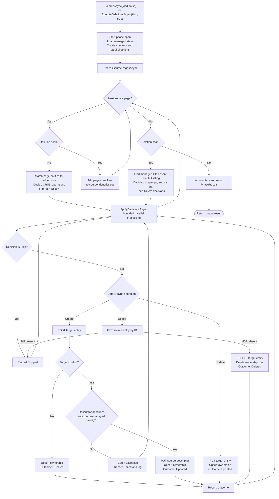

# PhaseExecutor: Line-by-Line Explanation

This document explains the implementation in
[`ApplicationLogic/Services/Export/PhaseExecutor.cs`](ApplicationLogic/Services/Export/PhaseExecutor.cs).
The line numbers below refer to that source file as reviewed on 2026-10-27. Blank lines are
omitted because they provide visual spacing only; every declaration, executable statement,
branch, and meaningful comment is covered.

## Phase flow at a glance

Both public methods enter the same private implementation. The `deletionsOnly` flag changes
what happens while source pages are read and whether missing managed IDs are processed after
the complete listing succeeds.

The per-decision exception handler catches `OperationCanceledException` along with other
exceptions and records a failure. Cancellation observed by `Parallel.ForEachAsync` itself can
still interrupt the loop. The diagram shows outcomes and control flow; it does not imply a
transaction across target HTTP writes and the ownership store.

## 1. Imports, class, and dependencies

| Source line | Explanation |
|---|---|
| 1 | Imports diagnostics types, especially `Activity`, used for tracing spans. |
| 3 | Imports `SourceUnavailableException`, used when source data cannot be read or verified. |
| 4 | Imports the Export Service tracing helper and its span/attribute names. |
| 5 | Imports CRUD decisions and their operation types. |
| 6 | Imports the state-store interface used to read and write ownership records. |
| 7 | Imports domain types such as entity kinds, phase results, and exported entities. |
| 8 | Imports the typed Export Service configuration. |
| 10 | Imports `IOptions<T>` to access the configured concurrency setting. |
| 12 | Places the class in the Export Service application-layer namespace. |
| 14 | Declares `PhaseExecutor` as a sealed class with a C# primary constructor. `sealed` prevents subclassing. |
| 15 | Injects the source reader, which streams source entities and verifies deletion candidates. |
| 16 | Injects the target writer, which creates, updates, and deletes target entities. |
| 17 | Injects the ownership state store, which tracks entities managed by this exporter. |
| 18 | Injects the decision maker that compares source entities with stored state. |
| 19 | Injects the options wrapper containing performance configuration. |
| 20 | Injects a typed logger and declares that this class implements `IPhaseExecutor`. |
| 21 | Opens the class body. |
| 22 | Saves the injected source reader in a private, read-only field. |
| 23 | Saves the injected target writer in a private, read-only field. |
| 24 | Saves the injected state store in a private, read-only field. |
| 25 | Saves the injected CRUD decision maker in a private, read-only field. |
| 26 | Reads the configured maximum parallelism and clamps it to at least one. Configuration validation should reject invalid values earlier; the clamp is a defensive fallback. |
| 27 | Saves the typed logger for phase and per-entity messages. |

## 2. Phase entry points and orchestration

| Source line | Explanation |
|---|---|
| 29 | Implements the normal forward-phase entry point by calling the private overload with `deletionsOnly: false`. The same cancellation token is passed through. |
| 31 | Implements the deletion-phase entry point by calling the private overload with `deletionsOnly: true`. |
| 33 | Declares the shared implementation. `kind` selects the AAS entity kind, `deletionsOnly` chooses the pass behavior, and the token propagates cancellation. |
| 34 | Opens the shared method body. |
| 35 | Starts a disposable `ExportPhase` tracing activity and tags it with the current entity kind. |
| 37 | Logs that processing for this entity kind has started. |
| 39 | Loads the existing ownership records for this kind once, before scanning source pages. A failure here escapes to the runner as a phase-level failure. |
| 40 | Creates thread-safe phase counters for created, updated, deleted, skipped, and failed outcomes. |
| 41 | Creates an ordinal identifier set only for deletion scans. `null` marks a forward scan; an empty set will be populated with every source ID before deletions are considered. |
| 42 | Begins constructing options for the parallel decision loop. |
| 43 | Opens the object initializer. |
| 44 | Applies the configured maximum number of concurrently processed decisions. |
| 45 | Passes the cancellation token to the parallel loop. |
| 46 | Closes the object initializer. |
| 48 | Reads all source pages. Forward mode processes each page immediately; deletion mode collects IDs. The method awaits the complete scan before continuing. `ConfigureAwait(false)` avoids capturing a synchronization context. |
| 50 | Checks whether the identifier set exists, which means this invocation is the deletion pass. |
| 51 | Opens the deletion-pass conditional block. |
| 52 | Compares the full managed-state list with collected source IDs and applies deletion candidates. This occurs only after the listing completes successfully. |
| 53 | Closes the conditional block. |
| 55 | Builds/logs the final phase result from the counters and tracing activity, then returns it. |
| 56 | Closes the shared phase method. |

## 3. Reading and routing source pages

| Source line | Explanation |
|---|---|
| 58 | Declares the asynchronous page-processing helper. |
| 59 | Receives the entity kind whose source endpoint will be read. |
| 60 | Receives the ledger snapshot loaded at the start of the phase. |
| 61 | Receives the optional source-ID set; it is non-null for deletion scans. |
| 62 | Receives the concurrency and cancellation options for decision application. |
| 63 | Receives the mutable, thread-safe phase counters. |
| 64 | Receives the token used while obtaining pages. |
| 65 | Opens the method body. |
| 66 | Builds a dictionary from identifier to managed entity using ordinal, case-sensitive comparison. Duplicate ledger identifiers cause dictionary creation to fail rather than silently selecting one. |
| 67 | Gets the asynchronous source-page enumerator and arranges to dispose it even if reading fails or is canceled. The token is supplied both to the reader and enumerator. |
| 69 | Requests pages one at a time. The loop stops when `MoveToNextPageAsync` returns `false`; a read error propagates. |
| 70 | Opens the loop body. |
| 71 | Tests whether the phase is collecting identifiers for deletion verification. |
| 72 | Opens the deletion-scan branch. |
| 73 | Adds the current page's identifiers to the set; page payloads are not retained for later deletion decisions. |
| 74 | Skips forward processing for this page and resumes the loop with the next page. |
| 75 | Closes the deletion-scan branch. |
| 77 | Processes this page's forward decisions and awaits their completion without capturing a synchronization context; the next page is not requested until processing finishes. |
| 78 | Closes the page loop. |
| 79 | Closes the page-processing method. |
| 81 | Declares a helper that advances the page enumerator and reports whether a page was available. It is static because it uses no instance fields. |
| 82 | Opens the helper body. |
| 83 | Starts a short-lived tracing span for fetching source entities. |
| 84 | Adds the current entity kind to the fetch span if tracing is enabled; `?.` makes this a no-op when no activity is listening. `_ =` intentionally discards the returned activity. |
| 85 | Advances the asynchronous enumerator and returns its Boolean result. |
| 86 | Closes the helper. |
| 88 | Declares the helper that extracts page identifiers into the scan set. |
| 89 | Opens the helper body. |
| 90 | Iterates over every entity in the page. |
| 91 | Opens the loop body. |
| 92 | Adds this source identifier. A `HashSet` naturally ignores duplicate IDs. |
| 93 | Closes the loop. |
| 94 | Closes the helper. |

## 4. Forward-page decisions

| Source line | Explanation |
|---|---|
| 96 | Declares the asynchronous helper for processing one forward page. |
| 97 | Receives the kind used for decision-making and logging. |
| 98 | Receives this page's source entities. |
| 99 | Receives the identifier-indexed ledger snapshot. |
| 100 | Receives the parallel execution settings. |
| 101 | Receives shared phase counters. |
| 102 | Opens the method body. |
| 103 | Creates a list sized for the page to hold only ledger rows relevant to its source entities. |
| 104 | Iterates over each source entity in the page. |
| 105 | Opens the loop body. |
| 106 | Looks up the current source ID in managed state and captures the matching ledger entity in `managed` if found. |
| 107 | Opens the successful-lookup branch. |
| 108 | Adds the matching ledger entity to the page-local state list. New source entities have no state row and are not added here. |
| 109 | Closes the lookup branch. |
| 110 | Closes the source loop. |
| 112 | Declares the list that will hold the CRUD decisions. |
| 113 | Starts a decision-making tracing span. Its scope covers the call that computes decisions. |
| 114 | Opens the span scope. |
| 115 | Tags the decision span with the current entity kind when tracing is active. |
| 116 | Calls the decision maker with this kind, the current source page, and matching ledger rows deduplicated by identifier. |
| 117 | Closes the decision call and span scope. |
| 119 | Applies non-Delete decisions for this page with the configured parallelism and cancellation token. Deletes are deferred until the complete source scan has established which managed IDs are missing. |
| 120 | Closes the forward-page helper. |

## 5. Preparing deletion decisions

| Source line | Explanation |
|---|---|
| 122 | Declares the helper that compares managed entities with the complete set of source IDs. |
| 123 | Receives the entity kind. |
| 124 | Receives all state rows for this kind. |
| 125 | Receives all identifiers found during the deletion listing. |
| 126 | Receives parallel execution settings. |
| 127 | Receives phase counters. |
| 128 | Opens the method body. |
| 129 | Selects ledger rows whose identifiers were not seen in the completed source scan, then materializes them. These are candidates only, not yet authorized deletions. |
| 130 | Declares the CRUD-decision list. |
| 131 | Starts a tracing span for the deletion decision calculation. |
| 132 | Opens the span scope. |
| 133 | Tags the span with the entity kind. |
| 134 | Asks the decision maker to compare an empty source list with the missing ledger rows, which yields delete decisions for those managed IDs. |
| 135 | Closes the decision span. |
| 137 | Applies only Delete decisions, passing the entity kind, bounded-parallelism options, and phase counters. |
| 138 | Closes the helper. |

## 6. Applying and counting individual decisions

| Source line | Explanation |
|---|---|
| 140 | Declares the helper that applies a decision sequence concurrently, receiving the kind, decisions, loop options, and shared counters. |
| 141 | Opens the helper body. |
| 142 | Starts `Parallel.ForEachAsync` with the decisions and configured parallelism/cancellation options. |
| 143 | Defines the per-item callback: each decision is sent to `ApplyDecisionAsync`, and the loop's token is forwarded. |
| 144 | Closes the parallel call and helper. |
| 146 | Declares the per-decision asynchronous handler. It receives the kind, decision, shared counters, and cancellation token; `ValueTask` supports its synchronous Skip path. |
| 147 | Opens the method body. |
| 148 | Checks whether no target or state mutation is required. |
| 149 | Opens the Skip branch. |
| 150 | Atomically records one skipped result. |
| 151 | Returns immediately, bypassing target I/O and the exception-handling block. |
| 152 | Closes the Skip branch. |
| 154 | Begins exception handling for non-Skip work. |
| 155 | Opens the `try` block. |
| 156 | Executes the decision, then records the resulting outcome only after the operation completes successfully. |
| 157 | Closes the `try` block. |
| 158 | Catches exceptions from this entity's processing. There is no special cancellation catch, so an `OperationCanceledException` thrown here is handled like another per-entity error. |
| 159 | Opens the exception handler. |
| 160 | Increments the failed counter atomically, including when the caught exception is an `OperationCanceledException`. |
| 161 | Logs the caught exception with operation, kind, and identifier. The message says other entities can continue, although cancellation observed by the parallel loop can still stop iteration. |
| 162 | Completes the log call and exception handler without rethrowing the caught exception. |
| 163 | Closes the helper. |

## 7. Creating the phase result

| Source line | Explanation |
|---|---|
| 165 | Declares the helper that turns counters into a result and publishes summary telemetry/logging. |
| 166 | Opens the helper body. |
| 167 | Copies the current counter values into an immutable `PhaseResult` for this entity kind. |
| 168 | Adds the created count to the phase span if it exists. |
| 169 | Adds the updated count to the phase span. |
| 170 | Adds the deleted count to the phase span. |
| 171 | Adds the skipped count to the phase span. |
| 172 | Adds the failed count to the phase span. |
| 174 | Begins writing the phase summary at Information level. |
| 175 | Defines the structured summary message and its placeholders. |
| 176 | Supplies the entity kind and all counter values for the placeholders, then closes the log call. |
| 178 | Returns the immutable phase result. |
| 179 | Closes the helper. |

## 8. Routing a CRUD operation

| Source line | Explanation |
|---|---|
| 181 | Declares the dispatcher. It returns the outcome actually achieved, which can differ from the requested operation. |
| 182 | Opens the dispatcher body. |
| 183 | Starts a tracing activity covering the target write/operation handling and disposes it on exit. |
| 184 | Tags the activity with the entity kind. |
| 185 | Tags the activity with the identifier. |
| 186 | Tags the activity with the requested operation. |
| 188 | Selects a branch based on the decision's operation. |
| 189 | Opens the switch body. |
| 190 | Matches a Create decision. |
| 191 | Delegates creation and returns its actual outcome, including possible descriptor conflict reconciliation. |
| 193 | Matches an Update decision. |
| 194 | PUTs the source payload to the target. `!` suppresses nullable analysis because Update decisions are expected to carry a source entity. |
| 195 | Writes the updated source hash and ownership data only after the target update succeeds. |
| 196 | Reports Updated after both target and state operations succeed. |
| 198 | Matches a Delete decision. |
| 199 | Delegates to deletion verification and returns its actual outcome, which can be Skipped. |
| 201 | Handles any unrecognized operation defensively. |
| 202 | Returns Skipped rather than mutating anything for an unknown enum value. |
| 203 | Closes the switch. |
| 204 | Closes the dispatcher. |

## 9. Create and conflict handling

| Source line | Explanation |
|---|---|
| 206 | Opens the XML documentation comment for the create helper. |
| 207 | States that the helper creates the entity in the target. |
| 208 | Explains that a 409 means the identifier already exists while this kind/ID has no ledger row. |
| 209 | States that reconciliation is allowed only if the adoption check proves the exporter created the described entity. |
| 210 | Closes the XML documentation comment. |
| 211 | Declares the asynchronous create helper, returning the actual outcome. |
| 212 | Opens the helper body. |
| 213 | Starts a `try` block around the target POST. |
| 214 | Opens the `try` block. |
| 215 | Sends the source entity to the target's Create operation. The null-forgiving operator reflects the invariant that Create decisions carry a source entity. |
| 216 | Closes the `try` block. |
| 217 | Catches only the special target conflict exception; other errors flow to per-entity failure handling. |
| 218 | Opens conflict handling. |
| 219 | Checks whether ledger evidence permits adopting this conflict. If not, the branch below refuses to modify the target. |
| 220 | Opens the non-adoptable branch. |
| 221 | Begins a warning log. |
| 222 | Supplies the conflict exception. |
| 223 | First part of the structured warning: the target already has an unmanaged entity. |
| 224 | Completes the warning text: do not modify the target; resolve the collision explicitly. |
| 225 | Supplies the entity kind. |
| 226 | Supplies the identifier. |
| 227 | Rethrows the original conflict so the per-entity handler counts this decision as Failed. |
| 228 | Closes the non-adoptable branch. |
| 230 | Begins an Information log for an adoptable generated descriptor. |
| 231 | First part of the message explains the target-generated descriptor scenario. |
| 232 | Completes the message: the source payload will replace it and ownership will be recorded. |
| 233 | Supplies the entity kind. |
| 234 | Supplies the identifier and closes the log call. |
| 236 | PUTs the source descriptor over the target-generated descriptor. This is the explicit conflict fallback, guarded by ledger evidence. |
| 237 | Records ownership after the PUT succeeds. |
| 238 | Returns Updated because the target entity existed and was reconciled, not newly created. |
| 239 | Closes the conflict handler. |
| 241 | On an ordinary successful POST, records ownership after the target write. |
| 242 | Returns Created after both the POST and ownership upsert succeed. |
| 243 | Closes the create helper. |

## 10. Deciding whether adoption is safe

| Source line | Explanation |
|---|---|
| 245 | Opens XML documentation for the adoption predicate. |
| 246 | Describes the method's purpose: determine whether a conflicting target entity can be adopted. |
| 247 | Restricts adoption to registry descriptors; integrated registries may create them as a side effect. |
| 248 | Explains the side effect: creating a shell or submodel can cause its descriptor to be generated by the target. |
| 249 | Notes that this generated descriptor is not directly created/recorded by this exporter. |
| 250 | Explains the shared-identifier relationship between a descriptor and the shell/submodel it describes. |
| 251 | Says an ownership row for that described entity is evidence connecting the descriptor conflict to this exporter's write. |
| 252 | Establishes the safety boundary: all other conflicts belong to unmanaged target data and are left untouched. |
| 253 | Closes XML documentation. |
| 254 | Declares the asynchronous predicate and returns a Boolean decision. |
| 255 | Opens the method body. |
| 256 | Uses the entity-kind relationship helper to find the described entity kind. If none exists, this kind is not an adoptable descriptor. |
| 257 | Opens the no-related-kind branch. |
| 258 | Returns false: this conflict cannot be proven to be a generated descriptor. |
| 259 | Closes the branch. |
| 261 | Starts a state-store lookup for the related shell/submodel. |
| 262 | Uses its described kind and the same identifier as the conflicting descriptor. |
| 263 | Passes cancellation, avoids synchronization-context capture, and completes the awaited lookup. |
| 265 | Returns true only if the related shell/submodel has an ownership record. |
| 266 | Closes the method. |

## 11. Recording ownership

| Source line | Explanation |
|---|---|
| 268 | Declares the helper that creates or updates the ownership-ledger row. |
| 269 | Opens the helper body. |
| 270 | Calls the state store's upsert operation. |
| 271 | Begins constructing the ledger entity. |
| 272 | Records the kind of entity being managed. |
| 273 | Uses the source entity's identifier; the null-forgiving operator assumes a write decision has a source payload. |
| 274 | Records current UTC time as the creation time supplied to the upsert. The database preserves the original value on conflict. |
| 275 | Records current UTC time as the latest successful synchronization time. |
| 276 | Stores the source JSON content hash used for future change detection. |
| 277 | Passes cancellation to the database operation and returns its task to the caller. |
| 278 | Closes the helper. |

## 12. Verifying and applying deletions

| Source line | Explanation |
|---|---|
| 280 | Opens XML documentation for deletion behavior. |
| 281 | States that the candidate is checked against the source by item GET before target mutation. |
| 282 | Makes source HTTP 404 the required evidence for deletion; a still-present object is skipped. |
| 283 | Describes how a verification error is treated: per-entity failure and preserved ownership for retry on a later run. |
| 284 | Names `SourceUnavailableException` as one such verification error and explains failure counting. |
| 285 | Explains that state remains when verification fails, allowing a future retry. |
| 286 | Closes XML documentation. |
| 287 | Declares the asynchronous deletion helper. |
| 288 | Opens the helper body. |
| 289 | Starts a tracing span that covers verification and the subsequent deletion/state cleanup. |
| 290 | Adds the entity kind to the span. |
| 291 | Adds the identifier to the span. |
| 293 | Logs that source GET-by-ID verification is beginning. |
| 295 | Calls the source reader. A returned entity means present; `null` means the source returned 404. Exceptions prevent deletion. |
| 297 | Checks whether the entity still exists at the source. |
| 298 | Opens the still-present branch. |
| 299 | Explains the expected discrepancy: the collection listing missed an entity that item lookup still finds. |
| 300 | Begins a warning log for that discrepancy. |
| 301 | First part of the warning identifies the entity and that the source still reports it. |
| 302 | Completes the warning: do not delete target/state; reconcile the source listing inconsistency. |
| 303 | Supplies the kind and identifier. |
| 304 | Returns Skipped, retaining the target entity and ledger row. |
| 305 | Closes the still-present branch. |
| 307 | Deletes the target entity only after source absence is confirmed. The target writer treats its own 404 as already gone. |
| 308 | Removes the ownership row only after target deletion succeeds or is accepted as already absent. |
| 310 | Begins an Information log for successful cleanup. |
| 311 | Describes source confirmation and removal from target and ownership state. |
| 312 | Supplies the entity kind and identifier and closes the log call. |
| 314 | Returns Deleted after both target and ledger operations complete. |
| 315 | Closes the deletion helper. |

## 13. Outcome values and concurrent counters

| Source line | Explanation |
|---|---|
| 317 | Opens XML documentation for the outcome enum. |
| 318 | Explains that actual work can differ from the planned decision. |
| 319 | Gives examples: a deletion can be skipped, or a create can become an update after safe conflict reconciliation. |
| 320 | Closes XML documentation. |
| 321 | Declares the private enum used to represent the actual operation outcome. |
| 322 | Opens the enum body. |
| 323 | Represents a newly created target entity with ownership recorded. |
| 324 | Represents a target entity updated and ownership recorded. |
| 325 | Represents a target entity deleted and its ownership row removed. |
| 326 | Represents a decision intentionally not applied. |
| 327 | Closes the enum. |
| 329 | Declares the private helper class that maintains counts across concurrent decisions. |
| 330 | Opens the counter class. |
| 331 | Stores the created count as an integer updated atomically. |
| 332 | Stores the updated count. |
| 333 | Stores the deleted count. |
| 334 | Stores the skipped count. |
| 335 | Stores the failed count. |
| 337 | Exposes a thread-safe snapshot of the created count using `Volatile.Read`. |
| 339 | Exposes the updated count with a volatile read. |
| 341 | Exposes the deleted count with a volatile read. |
| 343 | Exposes the skipped count with a volatile read. |
| 345 | Exposes the failed count with a volatile read. |
| 347 | Declares the method that increments the counter matching an actual outcome. |
| 348 | Opens the method body. |
| 349 | Selects a counter based on the outcome enum. |
| 350 | Opens the switch body. |
| 351 | Matches a Created outcome. |
| 352 | Atomically increments the created count. The discard assignment makes the intentionally unused return value explicit. |
| 353 | Ends the Created case. |
| 354 | Matches an Updated outcome. |
| 355 | Atomically increments the updated count. |
| 356 | Ends the Updated case. |
| 357 | Matches a Deleted outcome. |
| 358 | Atomically increments the deleted count. |
| 359 | Ends the Deleted case. |
| 360 | Matches a Skipped outcome. |
| 361 | Atomically increments the skipped count. |
| 362 | Ends the Skipped case. |
| 363 | Closes the switch. |
| 364 | Closes the `Record` method. |
| 366 | Declares and implements failure counting as one atomic increment. |
| 367 | Closes the counter class. |
| 368 | Closes `PhaseExecutor`. |

## 14. Whole-method flow

1. `ExecuteAsync` loads state and processes source pages in forward mode.
2. `ExecuteDeletionsAsync` loads state again, scans all pages to collect identifiers, then considers missing managed IDs.
3. Forward decisions are applied page by page; each page finishes before the next is requested.
4. Decisions within one page run concurrently, but counters remain atomic.
5. A deletion candidate is not deleted until an item GET confirms source HTTP 404.
6. Target mutations happen before ownership-state mutations. There is no transaction spanning the target and PostgreSQL.
7. An exception from an individual `ApplyAsync` call, including `OperationCanceledException`, is counted as a per-entity failure; cancellation observed by `Parallel.ForEachAsync` or outside that catch can still stop the phase.

The line references describe the current implementation, not a promise that the source remains
unchanged. Re-check `PhaseExecutor.cs` if the implementation changes.
